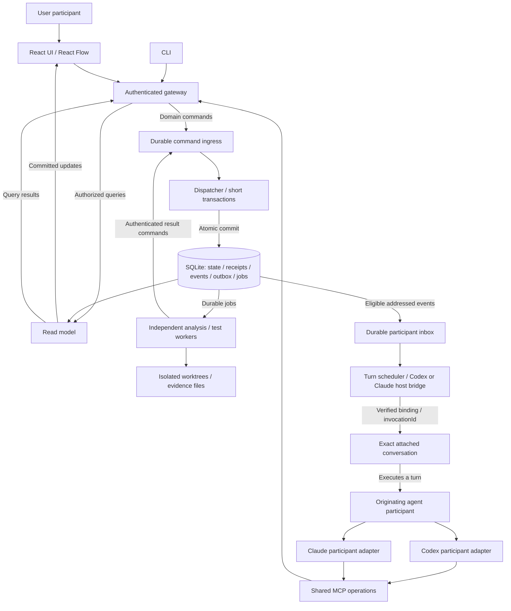

# High-level design

**Status:** Accepted direction, documented for further refinement

**Implementation:** Not started in this repository

## From vision to system

The [product vision](vision.md) calls for a connected understanding of changed behavior, with inspectable evidence and room for questions. The system brings source facts, agent interpretation and execution evidence into one review while keeping their identities and limits distinct.

The reviewer can enter at a behavior or a source detail, follow relationships and return without losing context. A compact context rail separates Epic/Ticket/PR source material from agent understanding, with provenance, freshness and explicit missing information. Behavioral groups account for the whole PR, including supporting configuration, documentation and tests.

Within a group, before-left and after-right source nodes expose colored changes alongside unchanged context, source-anchored explanations and related tests. Red means removal, green addition and yellow modification, with labels beyond color. There is no before/after mode toggle. One-hop callers and callees include unchanged dependencies and both source sides; unresolved relationships remain distinct from confirmed leaves.

The graph leads the explanation. Plain-English narration explains the already-highlighted behavior with a brief why, what/how and concrete example. Semantic zoom and manual expansion reveal detail without changing identity or losing selection. There is no API/Helpers orientation selector.

Preserve the slim, draggable bottom-center player: drag, previous, replay/pause, next and step count/chapter selection in one row. Mobile Flow/Diff shares the story cursor, reading pause and exploration/resume state. Icons serve operations with accessible names/tooltips; text carries review information. These are experience constraints for progressive delivery, not claims about an existing app.

## Technology direction

**Frontend:** React 19

**Canvas:** React Flow

**Frontend tooling:** Vite

**UI foundations:** decompozr/design-system

**Backend runtime:** Node.js

**Application language:** TypeScript with strict mode for frontend and backend

**Linting and formatting:** Tool selection deferred; Biome is not required

**Durable data:** SQLite

**Evidence storage:** Referenced source snapshots, patches and execution artifact files

These are accepted technology directions. Strict TypeScript compiler settings will be derived when an implementation slice establishes the scaffold. No dependencies or application scaffold are introduced by this document.

## Implementation conventions

Design specifically for React. There is no framework-agnostic core, reusable SDK or alternate-framework support requirement. Use React-specific components, hooks and bindings where they serve the product; do not add abstraction layers or separate packages solely for hypothetical framework portability. Logical subsystem boundaries still apply: React UI delegates business operations through public application interfaces rather than embedding domain rules or reaching into other subsystems' internals.

Use strict TypeScript for application code and tests. No lint/format tool is selected or required yet. Prefer functional patterns with explicit immutable inputs and isolated effects. This is a preference over classes, not a class ban; a class is acceptable when its responsibility warrants it. Keep the existing arrow-function preference; use function declarations only when required.

Choose React patterns according to the actual requirement; no particular component customization pattern is prescribed. Keep the design proportionate to the behavior being delivered. UI composition must retain accessibility, actual decompozr/design-system integration and the separation of business rules from UI. It must not create another path for cross-subsystem stream wiring.

The [functional/reactive contract](reactive-design.md) defines effect and subscription ownership. All code remains tested, preferably through TDD; implemented user journeys include actual design-system E2E coverage and own-PR dogfood. A convention documented here is an implementation requirement, not evidence that a configuration, build or user journey has passed.

### External reference and adoption boundary

These selected conventions were informed by the public Runway Avatar SDK at commit `917342729c1f23de20ba0238775dd003276c25b8`: [contribution guidance](https://github.com/runwayml/avatars-sdk-react/blob/917342729c1f23de20ba0238775dd003276c25b8/CONTRIBUTING.md#L74-L79) and [architecture guidance](https://github.com/runwayml/avatars-sdk-react/blob/917342729c1f23de20ba0238775dd003276c25b8/AGENTS.md#L21-L93). They are conventions of that public SDK, not established company-wide standards or interview requirements. PR Reviewer adopts the conventions above by project decision, not the external repository's instructions as a whole.

That SDK's documented design places LiveKit behind core and has React consume core events without direct LiveKit imports. Its pinned [React manifest](https://github.com/runwayml/avatars-sdk-react/blob/917342729c1f23de20ba0238775dd003276c25b8/packages/react/package.json) and [session component](https://github.com/runwayml/avatars-sdk-react/blob/917342729c1f23de20ba0238775dd003276c25b8/packages/react/src/components/AvatarSession.tsx#L18-L25) still directly depend on/import LiveKit. This is an observed implementation divergence, not proof that the documented isolation is complete. Its Biome choice, framework-agnostic package split and LiveKit dependency are not adopted here; PR Reviewer's own subsystem and managed-stream contracts remain authoritative.

## System diagram

## Subsystem boundaries

| Subsystem | Owns | Boundary |
|---|---|---|
| Review presentation | Canvas, context rail, story controls, exploration and private viewport | Renders read models and submits intent. Business rules remain outside UI components. |
| Review domain | Snapshots, coverage, groups, anchors, annotations, comments and shared focus | Validates domain commands through explicit interfaces, independent of transport and renderer. |
| Command processing | Durable ingress, receipts, deduplication and short atomic dispatch | UI, MCP, CLI and worker results use the same write path; jobs execute elsewhere. |
| Source analysis | Pinned source facts, diff coverage and candidate relationships | Returns evidence-backed results; cannot declare agent interpretation as parsed fact. |
| Execution and evidence | Configured test targets, durable jobs, process outcomes and artifacts | Returns result commands; cannot equate request acceptance with a passing test. |
| Participant delivery | Attachments, durable inbox and conversation-turn scheduling | A host adapter proves actual conversation delivery and reconciles uncertain wakeups. |
| Reactive integration | Declared public-port routes, managed subscriptions, scoped teardown and diagnostics | All cross-subsystem streams pass here; no direct internal-module subscriptions, hidden reciprocal wiring or replacement for durable command processing. |
| Persistence adapters | Transactions, projections and artifact storage | Expose contracts to the responsible subsystem; no UI, agent or worker writes around domain ingress. |

These are logical boundaries, not a requirement for separate services. A subsystem exposes a narrow public interface; consumers do not reach into its internals. Domain policy is tested independently of UI and transport adapters.

## Existing-session and functional boundaries

Support [Codex and Claude participant adapters](participant-adapters.md). The session initiating attachment in the current project is the exact responsible session; preserve its host owner, work and permissions. Both integrations are part of 480p, with independent probe and real own-PR evidence. A clone on another machine does not imply shared runtime state or access to a session on this machine.

Use a [functional core with reactive coordination](reactive-design.md): pure domain transitions, isolated effects, explicit lifecycle ownership and UI snapshot subscriptions. Reactive-library selection remains open; no stream library replaces durable commands or makes external effects exactly once. Cross-subsystem wiring is centralized in a declared integration layer and monitored subscription registry. Routes remain scoped, authorized and fault-isolated; central control does not mean one global serial worker.

## Commands, jobs and conversation turns

User and agent are authenticated participants using the same permitted actions through different entry points. Server-derived identity determines the actor; a supplied participant or conversation string is not proof of identity. Workers use scoped execution identities.

Every domain write uses durable command ingress: comments, replies, graph edits, shared focus, test requests, cancellation, attachment/inbox changes and internal results. Authorized reads go directly through the read model. Local hover and viewport stay private.

The dispatcher atomically commits domain state, a command receipt, events/outbox and any job creation. Transactions end before network calls, process execution or agent turns. Queue ordering follows consistency boundaries; it is not a global serial worker. Long jobs do not block comments.

Serialize conversation turns only. An agent awaiting MCP or a job must not hold a participant-wide command lock or domain transaction needed to satisfy its own request.

A successful test-request command means a job exists. Job launch, execution and terminal outcome require separate evidence. Cancellation records intent; cancelled requires confirmed termination. Missing launch or exit evidence remains unknown. External launches and wakeups use stable invocationId distinct from commandId, with host deduplication/query/reconciliation. Outbox replay does not guarantee exactly-once external effects. Unknown launch outcomes cannot be blindly retried; reuse of commandId with changed payload is rejected.

Attachments bind a verified host/conversation, generation and capabilities. Authorization and generation are rechecked when queued writes apply. Stale agent writes are rejected; independently authorized older jobs may retain correctly attributed historical results. A turn, a job and a participant have separate identities.

Wakeups come from addressed user requests or subscribed terminal job events. Own replies, ordinary graph changes and delivery receipts do not wake the agent again. Durable inbox items, cursors, consumption records and causal links survive restart. Coalescing wakeups retains every event. Saved, delivered, turn started, completed and answered remain distinct; unsupported wakeup is visibly pending/degraded.

Concurrency is action-specific: comments validate snapshot/anchor, resource edits use their own revision, and atomic graph patches use graph CAS. Unrelated comments do not invalidate graph edits. Receipts expose resulting revisions/cursors so queries provide read-your-writes or explicit projection-pending state.

## Source and evidence boundaries

Pin the PR head and the actual comparison baseline. Prepare an isolated head worktree and read-only baseline view; use a baseline execution worktree only for an actual comparison run. Resolve callers/callees from both sides, including removed callers and unchanged dependencies. Missing source and binary patches stay explicit. Import does not execute installation hooks.

Source anchors identify snapshot, side, path and span independently of graph layout. A new head creates a new snapshot; old comments/results remain historical. Coverage counts primary changed hunks once even when groups share context.

Keep parsed facts, agent interpretation and execution evidence separate. Role, mock/stub technique and reasoned risk are independent dimensions. Helpers are not inherently low-risk; request/response adapter describes repetitive mapping more precisely than assuming generated code. Human corrections survive enrichment.

Test source changes, relevance and execution results are different claims. Results identify actual worktree content/dirty state, environment, configured command, exit outcome and artifacts; a head SHA alone does not describe modified files. Base/head comparisons preserve separate results and environment differences.

## Delivery and validation

Follow the [progressive roadmap](plans/roadmap.md), with testable vertical slices inside each round. Before the first product loop, use the bounded [host contract probe](plans/probes/00-host-contract.md) to establish host feasibility without building the UI/comment path. Define the [comprehension task and source-backed expected account](plans/comprehension.md) before presentation implementation. The first product slice then proves the actual anchored question/reply journey. All code is tested, preferably through TDD. End-to-end checks exercise the real user journey and actual design-system integration; fixtures do not establish native host delivery, physical-device behavior or comprehension.

Every product slice must be [dogfoodable using our own real PR](plans/own-pr-dogfood.md), with the candidate source/build identified separately from the reviewed baseline/head and source anchors. The first runnable slice may use explicitly manual pinned-source acquisition; it does not claim a general importer or unsupported analysis/execution. Fixes and target-head changes require relevant revalidation. Same-agent dogfood is separate from unfamiliar-reviewer comprehension; the host feasibility probe is not product dogfood.

The first material unknown is the exact external conversation host: authenticated attachment, supported MCP transport, wakeup, deduplication and outcome-query capabilities must be proven. The first supported source language and configured repository test runner also need explicit selection before their respective analysis and execution slices; neither is required for the host-only probe. Real independent-job acceptance begins with whole-PR import, and graph CAS acceptance begins with graph-writing behavior, as scoped in the roadmap. These deferrals do not weaken the architectural contracts. The earlier Playground prototype is a reference, not a running implementation in this repository.

Hosted agent runtime, Decisions integration, generalized multi-agent ownership, remote workers and automatic external PR posting are deferred. This document defines a design-only endpoint; it does not authorize runtime implementation, installation or deployment.
