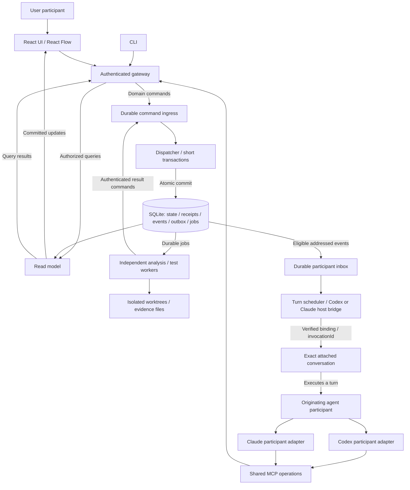

# High-level design

**Status:** Accepted direction, documented for further refinement

**Implementation:** Bounded React/SQLite/CLI/MCP milestone and read-only source graph merged. Immutable continuation/history has bounded independent engineering and actual own-PR navigation acceptance. Native Codex/Claude journey, full slice and unfamiliar-human acceptance remain separately open.

## From vision to system

The [product vision](vision.md) calls for a connected understanding of changed behavior, with inspectable evidence and room for questions. The system brings source facts, agent interpretation and execution evidence into one review while keeping their identities and limits distinct.

The reviewer can enter at a behavior or a source detail, follow relationships and return without losing context. A compact context rail separates Epic/Ticket/PR source material from agent understanding, with provenance, freshness and explicit missing information. Behavioral groups account for the whole PR, including supporting configuration, documentation and tests.

Within each original file group, one continuous Split or Unified source comparison exposes colored changes alongside unchanged context, source-anchored explanations and related tests; side identities remain distinct without becoming separate root nodes. Red means removal, green addition and yellow modification, with labels beyond color. There is no before/after mode toggle. One-hop callers and callees include unchanged dependencies and both source sides; unresolved relationships remain distinct from confirmed leaves.

The graph leads the explanation. Plain-English narration explains the already-highlighted behavior with a brief why, what/how and concrete example. Only explicit file activation/keyboard intent expands detail; gesture zoom/pan changes the camera only, preserving identity and selection. There is no API/Helpers orientation selector.

Preserve the slim, draggable bottom-center player: drag, previous, replay/pause, next and step count/chapter selection in one row. Mobile Flow/Diff shares the story cursor, reading pause and exploration/resume state. Icons serve operations with accessible names/tooltips; text carries review information. These are experience constraints for progressive delivery, not claims about an existing app.

## Technology direction

**Frontend:** React 19

**Canvas:** React Flow

**Frontend tooling:** Vite

**UI guidelines and principles:** decompozr/design-system; React implementation only, no Svelte dependency

**Backend runtime:** Node.js

**Application language:** TypeScript with strict mode for frontend and backend

**Linting and formatting:** Tool selection deferred; Biome is not required

**Durable data:** SQLite

**Evidence storage:** Referenced source snapshots, patches and execution artifact files

These are accepted technology directions. The first milestone derived strict TypeScript settings and a bounded application from slice 01. Later subsystems remain planned; see the [current delivery plan](../plans/delivery-through-1080p.md) and [continuation/import boundary](review-loop/evolution.md).

## Development rules

Follow the [implementation conventions](../rules/development.md) for strict TypeScript, functional preferences and React pattern selection. This document owns the product architecture; shared development rules have one home.

## System diagram

## Subsystem boundaries

| Subsystem | Owns | Boundary |
|---|---|---|
| Review presentation | Canvas, context rail, story controls, exploration and private viewport | Renders read models and submits intent. Business rules remain outside UI components. |
| Source inspection application | Authorized snapshot/comparison/context reading, byte verification, bounded detail and private structural frame | Public canvas read model/intents; workspace owns all incoming values and capture/restore routes. A read-only validation port stages exact target readiness before Story commits restoration. |
| Review domain | Snapshots, coverage, groups, anchors, annotations, comments and shared focus | Validates domain commands through explicit interfaces, independent of transport and renderer. |
| Command processing | Durable ingress, receipts, deduplication and short atomic dispatch | UI, MCP, CLI and worker results use the same write path; jobs execute elsewhere. |
| Source preparation | Bounded manual/provider pinned manifests, identity compatibility and verification witnesses | No database writes. Gateway verifies outside transactions; storage admits new source only with a matching nonserialized review/manifest witness. The candidate acquisition-v1 adapter preserves provider IDs and issues job/review/manifest-bound witnesses. |
| Source analysis | Pinned source facts, diff coverage and candidate relationships | Returns evidence-backed results; cannot declare agent interpretation as parsed fact. |
| Execution and evidence | Configured test targets, durable jobs, process outcomes and artifacts | Returns result commands; cannot equate request acceptance with a passing test. |
| Participant delivery | Attachments, durable inbox and conversation-turn scheduling | A host adapter proves actual conversation delivery and reconciles uncertain wakeups. |
| Reactive integration | Declared public-port routes, managed subscriptions, scoped teardown and diagnostics | All cross-subsystem streams pass here; no direct internal-module subscriptions, hidden reciprocal wiring or replacement for durable command processing. |
| Persistence adapters | Transactions, projections and artifact storage | Expose contracts to the responsible subsystem; no UI, agent or worker writes around domain ingress. |

These are logical boundaries, not a requirement for separate services. A subsystem exposes a narrow public interface; consumers do not reach into its internals. Domain policy is tested independently of UI and transport adapters.

## Existing-session and functional boundaries

Support [Codex and Claude participant adapters](participant-adapters.md). The session initiating attachment in the current project is the exact responsible session; preserve its host owner, work and permissions. Both integrations are part of 480p, with independent probe and real own-PR evidence. A clone on another machine does not imply shared runtime state or access to a session on this machine.

Use a [functional core with reactive coordination](reactive-design.md): pure domain transitions, isolated effects, explicit lifecycle ownership and UI snapshot subscriptions. Reactive-library selection remains open; no stream library replaces durable commands or makes external effects exactly once. Cross-subsystem wiring is centralized in a declared integration layer and monitored subscription registry. Routes remain scoped, authorized and fault-isolated; central control does not mean one global serial worker.

## Commands, jobs and conversation turns

The single local owner enters the established local/Tailscale workspace without application login; the gateway derives its local-user principal. Agents retain authenticated, scoped participant entry points. Server-derived identity determines the actor; a supplied participant or conversation string is not proof of identity. The local-owner policy does not claim Tailscale identity. Workers use scoped execution identities.

Every domain write uses durable command ingress: comments, replies, graph edits, shared focus, test requests, cancellation, attachment/inbox changes and internal results. Authorized reads go directly through the read model. Local hover and viewport stay private.

The dispatcher atomically commits domain state, a command receipt, events/outbox and any job creation. Transactions end before network calls, process execution or agent turns. Queue ordering follows consistency boundaries; it is not a global serial worker. Long jobs do not block comments.

Serialize conversation turns only. An agent awaiting MCP or a job must not hold a participant-wide command lock or domain transaction needed to satisfy its own request.

A successful test-request command means a job exists. Job launch, execution and terminal outcome require separate evidence. Cancellation records intent; cancelled requires confirmed termination. Missing launch or exit evidence remains unknown. External launches and wakeups use stable invocationId distinct from commandId, with host deduplication/query/reconciliation. Outbox replay does not guarantee exactly-once external effects. Unknown launch outcomes cannot be blindly retried; reuse of commandId with changed payload is rejected.

Attachments bind a verified host/conversation, generation and capabilities. Authorization and generation are rechecked when queued writes apply. Stale agent writes are rejected; independently authorized older jobs may retain correctly attributed historical results. A turn, a job and a participant have separate identities.

Wakeups come from addressed user requests or subscribed terminal job events. Own replies, ordinary graph changes and delivery receipts do not wake the agent again. Durable inbox items, cursors, consumption records and causal links survive restart. Coalescing wakeups retains every event. Saved, delivered, turn started, completed and answered remain distinct; unsupported wakeup is visibly pending/degraded.

Concurrency is action-specific: comments validate snapshot/anchor, resource edits use their own revision, and atomic graph patches use graph CAS. Unrelated comments do not invalidate graph edits. Receipts expose resulting revisions/cursors so queries provide read-your-writes or explicit projection-pending state.

## Source and evidence boundaries

Pin the PR head and the actual comparison baseline. Prepare an isolated head worktree and read-only baseline view; use a baseline execution worktree only for an actual comparison run. Resolve callers/callees from both sides, including removed callers and unchanged dependencies. Missing source and binary patches stay explicit. Import does not execute installation hooks.

Source anchors identify snapshot, side, path and span independently of graph layout. A new head creates a new snapshot; old comments/results remain historical. Coverage counts primary changed hunks once even when groups share context.

Keep parsed facts, agent interpretation and execution evidence separate. Role, mock/stub technique and reasoned risk are independent dimensions. Helpers are not inherently low-risk; request/response adapter describes repetitive mapping more precisely than assuming generated code. Human corrections survive enrichment.

Test source changes, relevance and execution results are different claims. Results identify actual worktree content/dirty state, environment, configured command, exit outcome and artifacts; a head SHA alone does not describe modified files. Base/head comparisons preserve separate results and environment differences.

## Delivery and validation

Follow the [progressive roadmap](../plans/roadmap.md), with testable vertical slices inside each round. Use established CLI session delivery and the [scoped integration checks](../plans/480p/probes/00-host-contract.md); App notifies the agent through CLI and the agent reads/replies through MCP. A generic host-feasibility experiment is not a prerequisite to product code. Define the [comprehension task and source-backed expected account](../rules/comprehension.md) before presentation implementation. The first product slice then proves the actual anchored question/reply journey. All code is tested, preferably through TDD. End-to-end checks exercise the real user journey and React UI behavior and design-guideline conformance; fixtures do not establish native host delivery, physical-device behavior or comprehension.

Every product slice must be [dogfoodable using our own real PR](../rules/own-pr-dogfood.md), with the candidate source/build identified separately from the reviewed baseline/head and source anchors. The first runnable slice may use explicitly manual pinned-source acquisition; it does not claim a general importer or unsupported analysis/execution. Fixes and target-head changes require relevant revalidation. Same-agent dogfood is separate from unfamiliar-reviewer comprehension; the host feasibility probe is not product dogfood.

The [first review-loop design](review-loop/README.md) defines concrete interfaces, state and CLI/MCP direction. Verify exact attachment, authorization, notification and MCP reply in the implementation; reuse earlier CLI/Playground knowledge instead of classifying the basic mechanism as unknown. The first supported source language and configured repository test runner also need explicit selection before their respective analysis and execution slices; neither is required for the host-only probe. Real independent-job acceptance begins with whole-PR import, and graph CAS acceptance begins with graph-writing behavior, as scoped in the roadmap. These deferrals do not weaken the architectural contracts. The earlier Playground prototype is a reference, not a running implementation in this repository.

Hosted agent runtime, Decisions integration, generalized multi-agent ownership, remote workers and automatic external PR posting are deferred. This document defines a design-only endpoint; it does not authorize runtime implementation, installation or deployment.

The slice03 candidate adds source-acquisition (read-only provider/Git values), import-jobs (one async owner and tracked processes) and import-artifacts (bounded private files, no authority) through public ports. The existing store owns job/review/receipt atomicity. React import presentation consumes application action/read models; it cannot schedule subprocesses. Exact ownership, restart, trust, persisted formats and current limits are maintained in [durable import jobs](review-loop/import-jobs.md). Candidate implementation/review status is separate from deployed-main evidence.

## Structural canvas candidate boundary

The [canvas reading contract](review-loop/canvas-reading.md) owns the separate inspection/draft/frame responsibilities and explicit source membership/restore rules. The preproduction React source canvas consumes the public inspection owner; graph/source code, comparison identity and document-reference facts still originate in the existing domain/read projections. UI cannot infer call edges or authorize source by filename. Snapshot-source links delegate to the workspace inspection port and remain separate from guarded question selection.

Workspace adds three declared managed routes: review-source-to-canvas-inspection, canvas-inspection-to-private-frame and story-frame-to-canvas-inspection. Access readiness, exact scope, settled revision and restore-owner gates prevent intermediate or superseded reads from replacing saved presentation. The structural renderer has one frame writer through those routes; legacy structural captureMap remains a compatibility port and is not a parallel renderer subscription. Existing semantic frame capture remains separate. Story awaits the canvas validation public port for both startup maps and Resume before publishing/consuming saved state. See [private compatibility](review-loop/persistence-compatibility.md#structural-inspection-additive-compatibility) and [story recovery](review-loop/story-and-exploration.md#structural-canvas-inspection-and-saved-story-state).

This is a reversible structural source integration candidate. Existing semantic, test, import and other presentation checkpoints are preserved; they have not all been moved into the primary canvas. Source engineering/author browser checks do not adopt a layout or prove fresh UI-first comprehension, native participant delivery, real test qualification or deployment.

## Code-informed rebuild reflection at the structural-canvas milestone

If rebuilding the whole current product tomorrow, preserve the existing authoritative layers: immutable acquired snapshot and explicit comparison identity; admitted semantic corpus/facts with exact source membership; attributed story/context/clarification; durable question/reply/inbox/receipt state; and independently owned import/analysis/test jobs and artifacts. Derive graphs and presentation from those values. Layout, a source highlight or a fixture result cannot become another authoritative fact store. Shared command idempotency/atomic SQLite admission stays separate from asynchronous process work and from reactive delivery. A single local owner changes authentication friction, not the need for exact addressed participant/session and uncertain-effect reconciliation.

Use React-specific functional application owners exposing immutable read snapshots and explicit intents. Each owner controls its read/command lifetime, scope and failure policy; one central managed integration registry coordinates public-port values and teardown. The workspace is the composition/lifetime owner, not a replacement for Story, source authorization, test execution or domain command policy. Pure shared response codecs should remain one browser-safe contract reused by UI/CLI clients rather than copied transport parsers. There is no demonstrated need for a framework-agnostic package, generic view-state framework or new reactive dependency.

The concrete canvas races justify a separate source inspection owner and a read-only preflight boundary. A canceled older digest previously could publish after an invalid exact restore; every restore must supersede old work before early validation. A valid initial/busy renderer value could otherwise overwrite a saved private map, so managed capture requires ready access/scope and settled restore ownership. Conversely, suppressing all capture until a promise continuation missed a newer same-turn user focus, causing exploration to save a frame different from the visible one. The correct owner reconciles a newer settled authorized revision synchronously and fences obsolete completions. Startup must stage both current and return inspections before exposing Resume; validation after frame consumption would lose retryability.

Keep these policies out of UI callbacks and stream operators. A second structural renderer frame writer would compete with the inspection owner; duplicating Story return rules in React would diverge on first-frame/draft/generation handling. Exact origin/neighbor/source intents are preferable to one vaguely named Open action: the latter previously conflated reading with question selection. Path/name inference is rejected for comparison identity; copies, renames, historical source and unsupported sides require explicit evidence or unavailable state. These alternatives would save little code while weakening correctness.

Accepted design remains one canvas with graph-connected readable source and distinct question/return ownership. The current structural candidate demonstrates only part of that design. Semantic/source utilities and other subsystem panels are still separate, some inherited browser journeys retain obsolete selectors, and independent renderer review identified overlapping-reference intent ordering and origin-card navigation defects; their bounded corrections are source-engineering READY after an unchanged independent counterexample and affected author Chrome checks. This does not close whole-product presentation or comprehension gates. Document these as implementation divergence, not revised product intent. Engineering test counts, mockups and author screenshots do not settle native participant behavior, production qualification, physical-device use or unfamiliar-reader comprehension. A fresh docs-only whole-product audit remains required before milestone knowledge acceptance.

The reference-ordering failure further confirms that every explicit inspection must reserve latest-intent ownership before its first await, rather than merely capture a shared access epoch. Access authorization and navigation ordering are separate guards. The origin-card failure confirms that presentation roles must dispatch the corresponding public intent: an exact primary origin is not a member of its own neighbor set. Preserve strict neighbor membership instead of weakening it to accommodate a mistaken UI callback. Bounded counterexamples and actual affected user journeys are preferable to another general navigation abstraction.
