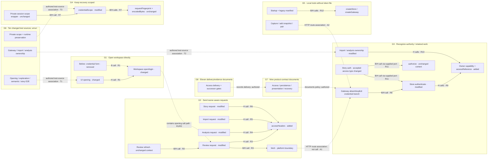

# PR25: one persistent whole-change graph

Date: 2026-10-24. Status: concrete design specification for independent review, not an implemented graph or accepted mockup. This restores the controlling October 23 change-tree/change-group contract. The rejected 8476 single-path mock and locked pan/zoom do not satisfy it.

Target: [our PR25](https://github.com/scottchu/pr-reviewer/pull/25). Baseline `b096826e31c0927190806de91ed70b8b64aa93d8` (B); head `e3b270e5f49a9215452b0b86702946043e979059` (H). The source was read from local immutable Git objects; no live PR/runtime/network claim is made. The next mock's source/build identity is separate.

Date of latest root correction: 2026-10-25.
Status: revision-2 same-file-node relationship mockup adopted; bounded implementation authorized.
The [active F18 contract](pr-file-tree-first.md) controls root presentation: original file nodes/names/status colors/dimensions/expand remain, only folder containment is removed from the default and positions/connections project exact caller→callee evidence. File tree is an icon-switched alternate. No root callable DAG, Before/After partitions or new responsibility frames. The authored G1–G8 organization and spatial proposals below are retained historical/source-accounting context, **not current layout instructions**. Their source-grounded PR facts, provenance and coverage limits remain useful.

## Source account and superseded spatial proposal

The central change is removal of human credential entry in a single-owner workspace while retaining explicit participant credentials, stored ownership and source/recovery boundaries. That sentence is an authored account supported by the changes below, not a result of execution or proof of network security. There are multiple coupled responsibilities, not just a request-header helper.

The browser’s localOwnerSession string is a nonsecret lifecycle marker; storage’s localOwnerAccess is an identity-checked in-process object capability. They are not the same credential and do not call one another. The gateway receives a missing header and selects its actual store.localOwner; explicit Bearer still follows authentication. Import/analysis retained-job access changes are independently visible G3 behavior, not merely another client header edit.

Eight persistent behavior/support groups account for all 50 changed files. They are authored organization, not extracted call facts. Their positions provide an initial spatial arrangement: opening at upper left, client requests beside it, gateway/owner recognition to the right, retained-work/recovery beneath the client/authority boundary, runtime tools below opening, tests beside their subjects, and two compact documentation groups at the bottom edge. Position conveys organization, not execution order. Free pan/zoom and direct group/member selection work immediately, without starting a story or completing a previous step.

| Group | Meaning and visible overview content |
|---|---|
| G1 Open the workspace directly | Changed UI opening and workspace orchestration; former credential form is a removed before member, automatic opening is its after counterpart. Keep read/recovery readiness visible. |
| G2 Send owner-aware requests | Review, analysis, import and story clients use a new header helper. Show all four callers around the shared helper; unchanged refresh/query callers remain grey context. |
| G3 Recognize authority and retain owned work | Gateway distinguishes absent versus explicit Authorization; storage recognizes its nonserialized owner capability and adapts import/analysis/story ownership. Separate authentication, authorization and persisted credential-reference meaning. |
| G4 Keep private question recovery scoped | New local-owner scope recipe while preserving the legacy credential scope distinction; unchanged hashing and byte measurement are visible downstream context. |
| G5 Run local tools without human-token files | Startup no longer creates/requires human credentials; capture/add-snapshot/pair requests omit that header; legacy manifest member becomes optional. Pairing still concerns existing participant attachment, not permission to replace sessions. |
| G6 Check owner access and preservation | Ten changed test files, grouped by the responsibility each exercises; visibly adjacent to G1/G3/G4/G5 through labeled test-source associations. Tests are source definitions, not current results. |
| G7 Explain the access contract | Nine product documents explain access, persistence, import, presentation and recovery effects. Compact actual canvas group with expandable file/diff members, not an off-canvas checklist. |
| G8 Record delivery and remaining gates | Eleven planning/evidence documents update delivery scope and successor assumptions. Compact actual canvas group, distinguished from product/source facts. |

A file has one primary accounting group; it may have references from several groups. G6 test members can be presented near their subject with one canonical identity and cross-group connectors rather than counting duplicate files. G7/G8 remain visible collapsed members at overview. Collapsing source bodies reduces detail, not graph membership. Every changed hunk belongs to its primary file/group, including unmodeled changes. Supporting material does not require fake function calls to deserve a place.

## Inspectable graph design

This Mermaid is an overview of meaningful graph members and relation kinds, not the full declaration inventory or the layout engine. Before/after source members and exact one-hop evidence expand from these nodes according to the table below. All eight groups exist before any story overlay. The separately listed 50-file ledger supplies the complete membership; it is necessary coverage data, not a substitute for this relationship map.

**Legend:** solid arrows labeled B/H are source-observed call expressions on the named side(s), not runtime traces or automatically admitted parser facts. A B-only dashed call must retain its explicit B label; dash alone never means removed. Dotted/dashed non-call arrows are named HTTP, test-source or authored-document associations. Comparison links inside groups are labeled “before/after comparison” and use a distinct non-directional treatment in the mock; no generic causal arrow. Grey/context means unchanged bytes/body in the cited scope, not unimportant. Green/red/yellow describe additions/removals/modifications, never passing/failing/risk. Every relation opens its exact evidence; arbitrary cross-group proximity is not a relation.

The collapsed workspace→review-request connector is an opening call-path summary: workspace calls review.login, which calls refresh and then request. Expanding it exposes those intermediate members; it must never be labeled a direct workspace→request call.

## Both-side one-hop evidence and explicit frontiers

Each changed executable member needs independently identified incoming and outgoing neighbors for B and H. “Same name” does not establish pairing, “unchanged” does not mean absent, and a complete file ledger does not establish complete relationship coverage. The following source-read examples are required anchors for the next mock. Line references refer to the immutable objects above. These are author-verified source relationships, not a claim that the current analyzer has admitted every relation.

| ID / changed region | Before incoming → changed member → outgoing | After incoming → changed member → outgoing |
|---|---|---|
| R1 Opening | UI main.tsx118 calls workspace.login; workspace.ts28–37 calls review.login31, analysis.login35, story.login36. | UI main.tsx101 calls workspace.open,104 calls imports.open. workspace.ts41→login19–28→review.login22, analysis.login26, story.login27. The old form is removed, not a hidden current step. React effect scheduling is framework context, not an inferred ordinary source caller. |
| R2 Review request context | application/review.ts refresh34–44 calls request at37; request24–31 calls fetch29. | refresh35–45 calls request38; request25–32 calls fetch30 and helper30. Refresh body is unchanged; display both side occurrences, not just after context. Other request callers remain reachable in the file rather than claiming refresh is the only caller. |
| R3 Shared header helper | No local-access.ts/helper exists. Review request29 constructs Bearer inline and calls fetch; absence is an added helper, not an empty before implementation. | application/local-access.ts1–3 defines helper; review30, analysis50, imports24 and story168 call it. Its body is a string comparison/returned object; no user-function callee is present in that body. Platform fetch remains the callers' downstream boundary. |
| R4 Analysis client | application/analysis.ts read/query call78→request48–52→fetch49. | query79→request49–53→accessHeaders50 and fetch50. Other retained source/read/command call sites at62,99,110,159 are additional incoming context, not removed by selecting query. |
| R5 Import client | application/imports.ts refresh36→request21–29→fetch22. | refresh37→request22–30→accessHeaders24 and fetch23. Command caller56 also remains. Unchanged refresh logic is context; the header policy is changed. |
| R6 Story client | application/story.ts context read177 and story read192→request165–168→fetch167. | context read178 and story read193→request166–169→accessHeaders168 and fetch168. Evidence/history request callers remain in the source; full generic call enumeration is not claimed here. |
| R7 Private scope | private-session.ts scope wrapper56→credentialScope29→requestFingerprint28 and encodedBytes27. | wrapper57→credentialScope30→requestFingerprint29 and encodedBytes28. Wrapper/hash/byte bodies are unchanged. New local-owner branch changes preimage; old credential branch remains, not a migrated record. SHA-256/WebCrypto is a platform boundary. |
| R8 Gateway access | server/public.ts61–65 requires Bearer and calls store.authenticate64. Missing header rejects. Subsequent routes pass the sliced token. | server/public.ts61–70 distinguishes absent/explicit header and calls store.authenticate67. Subsequent routes pass access. Incoming HTTP is a transport boundary; do not turn browser fetch into a direct function call. Existing readBody15–29 and send30–37 remain unchanged callees of routes, with source citations on expansion. |
| R9 Store authentication | storage/public.ts198–201 and exported authenticate283–290 look up a hashed credential; storyEvidence204 and injected story auth call authentication. | storage/public.ts200–204 calls accessReference and localPrincipal before credential lookup; exported authenticate uses this same function. access.ts8–14 distinguishes identity-branded owner versus strings. Hash/SQLite operations are library/platform boundaries; no claim of a live DB result. |
| R10 Retained import/analysis work | storage/imports.ts command34–71/list75 use hash(token), user27 and credential-reference equality; storage/analysis.ts credential76 and command/auth paths use stored credentials. | imports.ts command37–73/list76 call accessReference/localPrincipal/isLocalOwner; analysis.ts credential78, command153, cancellation231 and queries268–295 use the same helper family. Imported/analysis owned jobs can remain accessible without rewriting historical credential rows. File-level expansion must expose distinct command/list/query nodes; exact callbacks/dynamic dispatch not resolved by this table remain labeled unmodeled. |
| R11 Story authorization | storage/story.ts context30/command33/query91 call auth24; auth calls supplied authenticate, load, authorize. Storage public274 supplies these ports. | context31/command34/query92 call auth25; storage public277 supplies the same ports with expanded access type. storage/public.ts authorize B74–85/H76–87 body is unchanged and checks agent review/attachment/generation/actor. An owner convenience must not be explained as bypassing agent authorization. |
| R12 Runtime tools | scripts/dev.ts creates store26 and gateway37; it also loads/issues human token27–35. pair request60+ reads human credential; add-snapshot12–13 reads token then fetches. | dev.ts25/27 keeps store/gateway construction and removes token initialization. pair.ts request57–68 is called at70/76 and omits human header; add-snapshot12 fetches without it. capture script similarly removes credential read/form fill. Source-local calls are distinct from external process/network effects, which were not run. |

A1 is a source-backed endpoint association, not proof of execution: review request's `/api/reviews/…` in application/review.ts38 matches gateway route handling. A2 similarly links local tool endpoint strings to gateway routes. The mock must show method/path/source citation when labeling these associations. Do not draw a single undifferentiated “calls” line across the network.

T1 associates the changed review/import/semantic/story/exploration E2E source with its exercised opening journey. T2 uses tests/gateway.test.ts89–115, import-jobs.test.ts36 onward and semantic-storage.test.ts96 onward for local owner/legacy jobs/explicit invalid credential cases. T3 uses question-recovery.test.ts19–26 (scope separation) and runtime.test.ts39,88–95 (no human credential required, old file preserved). These are source assertions, not passes. Unchanged test cases in those same files are retained context nodes when directly relevant; unchanged assertion text does not prove continued relevance or success.

**Coverage frontier:** this packet provides concrete relationship anchors across the changed client, gateway, storage, private recovery and tool responsibilities. It is not exhaustive function/callback resolution for all 50 files. For each expanded changed declaration, the mock must show separate B incoming/B outgoing/H incoming/H outgoing completeness indicators: observed neighbors, proven local no-call body, external/dynamic boundary, or not yet modeled. Do not call a missing incoming list “no callers”. Additional source-backed one-hop nodes may be prepared without changing target; unsupported callbacks/cross-repository dependencies remain visible gap members with their originating side/span. Documentation/CSS/type-only changes use actual references/usage or explicit unmodeled impact, never fabricated function calls. A candidate that models only R2/R3 and hides every other region cannot pass as this whole-PR design.

## Spatial contract: overview → detail → return, not screens

- **Overview:** all G1–G8 envelopes, meaningful changed-region nodes, visible cross-group relations and collapsed context/test members exist in one scene. A viewport may not physically fit every label at reading size, but Fit overview reveals every group; pan/recenter and accessible navigation reach all members without story progression. The overview cannot reduce G3–G8 to a “remaining scope” paragraph.
- **Neighborhood:** activating any group/member emphasizes its evidenced one-hop callers AND callees on both sides, including unchanged source. Other groups retain stable identities and positions, dimmed only enough to preserve legibility. Context expansion has an explicit frontier and side-specific unknowns. Neither Next nor a mode picker unlocks these nodes.
- **Detail:** zoom or explicit expansion reveals before-left/after-right source, inline red/green/yellow changes, connected short explanation claims, related test source/results and anchor-adjacent comment markers *inside that group's bounds*. Extended explanation opens at right; thread/composer opens from below under the [panel contract](review-loop/canvas-panels.md). Narrow layout may stack labeled sides within the group; it is not a new page or substituted graph. Independent local source scrolling and text selection do not pan accidentally. Source absence/unknowns stay visible.
- **Space:** initial group locations are stable. Expanding a group may reserve/reflow adjacent space locally with a visible transition; unrelated groups must not be regenerated or reordered to match story steps. Camera moves only on user navigation or explicit follow-story, with reduced-motion equivalent. Pan/zoom is never locked to simulate a focused screen. Fit overview is framing, not reset; collapse is detail reduction, not membership removal.
- **Return:** Back restores prior viewport, expanded groups and inspected selection; it does not discard additions to shared evidence. Optional Resume restores the saved story attention frame and pauses. Exact snapshot, source anchors, draft/uncertain command identity and thread attachment remain protected by existing application contracts. Restore failure preserves frames/drafts and shows the actual gap.
- **Story overlay:** a story references existing members and may change emphasis, explanation and, only with explicit follow enabled, camera attention. It cannot replace membership, swap the canvas for a slide, hide unrelated groups, manufacture links or auto-advance to reveal otherwise absent source. With story off or unavailable the complete graph remains navigable. User exploration pauses following; one-row player is secondary and removable from the first-open burden when no story exists.
- **Comments:** code/prose selection exposes contextual Comment with exact identity/version/span; markers remain attached as detail changes. Unsupported prose persistence remains mock-only. Counts cluster on collapsed groups, but source/draft/author identity never migrates to a nearby node. Test execution controls appear only for existing configured targets; this design grants no new runner capability.

The selected dark editor visual foundation remains the baseline, but the controlling layout is the October 23 persistent whole-PR canvas. An older lesson/sidebar image cannot override it. Geometry and interaction feel still need a new mock; this document does not claim pixel or live-device proof.

## Complete primary file accounting

The following rows are mechanically derived from `git diff --numstat B H`, with authored primary group assignment. All 50 files are text, four added and 46 modified; no deleted/renamed file is present in this comparison. Full-file ownership assigns every changed hunk to one group without double counting. Files can still supply shared context across groups. No claim of complete semantic explanation follows from these counts.

| Primary group | Changed file | Added / removed lines |
|---|---|---|
| G8 | `docs/plans/1080p/plan.md` | +1 / −1 |
| G8 | `docs/plans/480p/plan.md` | +1 / −1 |
| G8 | `docs/plans/480p/slices/01-review-loop/plan.md` | +4 / −0 |
| G8 | `docs/plans/480p/slices/01-review-loop/single-user-access/evidence.md` | +83 / −0 |
| G8 | `docs/plans/480p/slices/01-review-loop/single-user-access/plan.md` | +71 / −0 |
| G8 | `docs/plans/480p/slices/02-review-continuation/plan.md` | +6 / −0 |
| G8 | `docs/plans/720p/slices/03-whole-change/plan.md` | +6 / −0 |
| G8 | `docs/plans/720p/slices/04-behavior-neighborhood/plan.md` | +6 / −0 |
| G8 | `docs/plans/720p/slices/05-explanation-exploration/plan.md` | +6 / −0 |
| G8 | `docs/plans/delivery-through-1080p.md` | +5 / −1 |
| G8 | `docs/plans/roadmap.md` | +2 / −2 |
| G7 | `docs/product/architecture.md` | +1 / −1 |
| G7 | `docs/product/review-loop/contracts.md` | +4 / −4 |
| G7 | `docs/product/review-loop/evolution.md` | +2 / −2 |
| G7 | `docs/product/review-loop/import-jobs.md` | +7 / −3 |
| G7 | `docs/product/review-loop/persistence-compatibility.md` | +6 / −2 |
| G7 | `docs/product/review-loop/presentation.md` | +7 / −3 |
| G7 | `docs/product/review-loop/runtime.md` | +10 / −6 |
| G7 | `docs/product/review-loop/semantic-storage.md` | +4 / −0 |
| G7 | `docs/product/review-loop/story-and-exploration.md` | +10 / −2 |
| G5 | `scripts/add-snapshot.ts` | +1 / −2 |
| G5 | `scripts/capture-review.ts` | +2 / −4 |
| G5 | `scripts/dev.ts` | +1 / −12 |
| G5 | `scripts/local.ts` | +1 / −1 |
| G5 | `scripts/pair.ts` | +0 / −4 |
| G2 | `src/application/analysis.ts` | +3 / −2 |
| G2 | `src/application/imports.ts` | +9 / −5 |
| G2 | `src/application/local-access.ts` | +3 / −0 |
| G4 | `src/application/private-session.ts` | +2 / −1 |
| G2 | `src/application/review.ts` | +4 / −3 |
| G2 | `src/application/story.ts` | +2 / −1 |
| G1 | `src/application/workspace.ts` | +15 / −11 |
| G3 | `src/server/public.ts` | +13 / −10 |
| G3 | `src/storage/access.ts` | +14 / −0 |
| G3 | `src/storage/analysis.ts` | +14 / −12 |
| G3 | `src/storage/imports.ts` | +7 / −5 |
| G3 | `src/storage/public.ts` | +8 / −10 |
| G3 | `src/storage/story.ts` | +6 / −5 |
| G1 | `src/ui/main.tsx` | +10 / −26 |
| G1 | `src/ui/style.css` | +3 / −6 |
| G6 | `tests/exploration-recovery.e2e.ts` | +5 / −5 |
| G6 | `tests/gateway.test.ts` | +27 / −0 |
| G6 | `tests/import-jobs.test.ts` | +12 / −0 |
| G6 | `tests/import.e2e.ts` | +6 / −6 |
| G6 | `tests/question-recovery.test.ts` | +8 / −0 |
| G6 | `tests/review.e2e.ts` | +31 / −21 |
| G6 | `tests/runtime.test.ts` | +20 / −0 |
| G6 | `tests/semantic-storage.test.ts` | +11 / −0 |
| G6 | `tests/semantic.e2e.ts` | +6 / −6 |
| G6 | `tests/story.e2e.ts` | +6 / −6 |

Verified total: 50 unique primary files, +492 / −192. This is source accounting, not a run result. Counts and status come from the fixed Git diff; group names are authored.

There are163 zero-context diff hunks across these50 files.

The [complete membership/range data](pr25-change-membership.json) records every file's primary group, before/after Git blob ID and all zero-context diff-hunk ranges. It contains no source code. Its keys are design locators, not invented admitted graph IDs. Zero-line sides mean absence and cannot accept a line comment. The next mock loads exact bytes from these pinned objects and exposes each hunk inside its persistent file/group; it must not turn this JSON into the only view of supporting changes.

Existing test-context example: `tests/gateway.test.ts:9–77` is unchanged in this comparison, while new owner-access assertions appear at H89–115. Keep the existing authenticated owner/bootstrap/agent-boundary test as a grey context member adjacent to the new owner test; its source status, authored relevance and unrun execution state remain separate. It is not a new test or proof that agent delivery succeeded.
