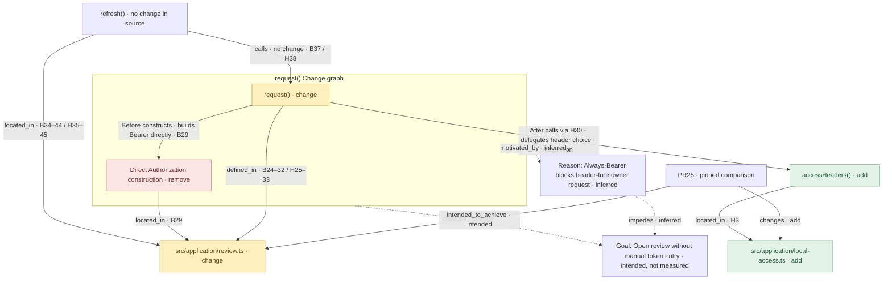
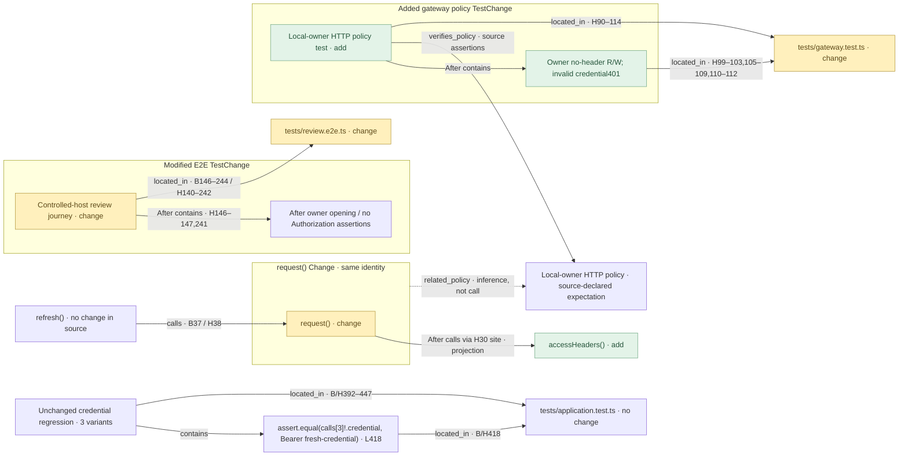

# PR25 ABox: concrete project and source account

Date:2026-10-27. Status: bounded prepared instance/evidence account, not a new schema, general extraction, runtime result or whole-product acceptance. This instantiates the [TBox](project-repository-tbox.md), which owns definitions and constraints. [Ontology index](project-repository-ontology.md).

## ABox: concrete PR Reviewer project, repository and review

The following are human-readable instance labels, not newly allocated persisted IDs or an invented storage format.

```text
Project: PR Reviewer
  goal: help reviewers understand change, rationale and evidence
  usesRepository → Repository: github.com/scottchu/pr-reviewer
  hasSpecification → docs/product/pr-file-tree-first.md
  hasRule → docs/rules/development.md (readable multi-line implementation)

Repository: github.com/scottchu/pr-reviewer
  hasReviewSubject → PR #25
  hasRevision → b096826e31c0927190806de91ed70b8b64aa93d8 (base)
  hasRevision → e3b270e5f49a9215452b0b86702946043e979059 (head)

Review subject: PR #25
  examinedAs → Comparison(base, head above)
  hasChange → request behavior Change account
  changes → File: src/application/review.ts (comparisonStatus: change)
  changes → File: src/application/local-access.ts (comparisonStatus: add)
```

These explicit Project and Repository boxes can appear in a project-knowledge view. They represent distinct entities connected by `usesRepository`, not two decorative names for the same object. The same repository is both where PR Reviewer is developed and the subject of its own PR25 dogfood review. These are two roles of one repository; the product project, review session, candidate build and pinned comparison remain distinct. There is no circular “the UI verified itself” acceptance implication.

| Concrete instance account | Basis and limit |
|---|---|
| Requirement F06: even a one-line edit initially shows its entire responsible changed callable on each available side; unrelated intervals may fold | Current `pr-file-tree-first.md` F06. This is a normative requirement instance, not evidence the UI implements it. Appropriate inner callable and honest module/declaration fallback are part of it. |
| Requirement F16: selected changed function → relevant test assertion summaries → same-canvas full-test diff | Current F16. Source-backed mapping includes relevant unchanged tests. No concrete TestRun/PASS is invented for the mock. |
| Rule: readable multi-line function bodies, conditions, object literals, operations and SQL | `docs/rules/development.md:7`. A project policy instance; original reviewed fixtures keep their exact bytes. This rule is not a function relation, and it selects no formatter/dependency. |
| FileOccurrence: `src/application/local-access.ts` at PR25 head; added callable `accessHeaders` | Current F10/F13 and the retained whole-PR source account. Base has no corresponding file/helper; head request callsite in review.ts calls it. Exact hash/range must come from the retained source record before creating an executable anchor. |
| Unchanged `refresh` occurrences before/after the request change | F10 retains both exact source occurrences and identical-body evidence. Its source is unchanged; downstream behavior may differ. Do not merge occurrences solely by name or infer behavior equivalence. |
| Comparison membership:50 changed paths,4 added/46 modified, +492/−192 lines | F13 pins the source.126 native -U3 hunks and163 -U0 blocks are different diff representations of that comparison, not different PRs or contradictory ontology facts. |
| Explanation: local-owner access is recognized before credential lookup; explicit credentials continue through lookup | Prepared account in F09 with source citations required. This does not prove blanket security or execution. Evidence status remains visible separately from explanation text. |
| Historical worktree locator: `/tmp/pr-reviewer-pr-file-tree` | Observed author working-copy location. Its moving HEAD is not PR25 head and is not a durable identity for Project, Repository or Comparison. |

## PR25 units: top-down and bottom-up

Within the pinned PR25 Comparison, the logical review File contains the actual request declarations (Before24–32/After25–33). Its Before29 direct Authorization construction and After30 accessHeaders(captured) callsite explain the request Change at smaller granularity; their Before/After link is comparison, not an execution step between revisions. The After callsite targets accessHeaders at local-access.ts Head3 through the evidenced call relation. That helper belongs to another File: dependency across Files is not containment inside request or review.ts.

Read bottom-up from these exact expressions/sites to request's header-behavior comparison, its changed File's role in PR25, and the prepared intended goal of opening review without manual token entry. The last step is an attributed intent/contribution explanation, not a proven source call, executed outcome or certified author intent. The unchanged refresh→request Before37/After38 path supplies affected caller context without claiming unchanged runtime behavior. Read top-down through the same evidence and logical identities to check those distinctions.

Relevant test contexts remain separately supported: the unchanged application's explicit-credential assertion418, added gateway HTTP-policy test90–114 and modified E2E each have their own scope and not-run limits. Neither those source definitions nor this local contribution account explains every changed File or proves the PR goal. Scope/frontier remains the prepared example; do not silently turn it into whole-PR impact coverage. This concrete account instantiates the separate TBox contract; neither document is a formal deployed ontology.


### Concrete relation and evidence crosswalk

Comparison repository: scottchu/pr-reviewer. Base: `b096826e31c0927190806de91ed70b8b64aa93d8`. Head: `e3b270e5f49a9215452b0b86702946043e979059`. Source witnesses below use those immutable revisions, exact side/path/range and hashes retained in the linked records. Short B/H labels are reading aliases, not replacement source identity.

| Unit / existing typed statement | Exact source / limit |
| --- | --- |
| PR25 `changes` review File and local-access File | Explicit comparison-qualified relation, admitted by native File diff evidence below; statuses change/add respectively. Not lexical containment or whole-PR effect coverage. |
| request `defined_in` review File | Before declaration24–32 / After25–33; two witnesses of ONE logical function/File. Metadata declaration provenance is distinct from changed-content evidence. |
| request Before `constructs` direct Authorization | review.ts Base29. Removed direct construction only, not global removal of Bearer headers. |
| request After `contains_call` accessHeaders(captured) site | review.ts Head30. This is the actual caller's callsite, not the callee definition. |
| After callsite `calls` accessHeaders | Resolved target is local-access.ts Head3. Cross-file dependency, never lexical ownership by request/review.ts. |
| Header/site `located_in` SAME logical review File | Header Base29–29; callsite Head30–30. Commit/range/side/hash belong to the respective relationship evidence. |
| Helper `located_in` local-access File | Head3–3. Do not relocate it to review.ts to simplify a diagram. |
| refresh `calls` request; refresh `located_in` review File | Call witnesses Base37/Head38; declaration witnesses Base34–44/Head35–45. Neutral source equality does not prove unchanged runtime behavior. |
| Changed/unchanged tests and policy context | Modified E2E, unchanged application assertion418, added gateway definition90–114; precise direct/indirect/policy scopes, all not run. Checked missing side stays provenance, never a fake Before entity. |

Read top-down: PR scope → changed File role → request comparison → exact Before construction / After callsite. Then follow the existing call to the external helper and its own File evidence. Read bottom-up through those same statements to explain how the smaller source change contributes to the request/File account and prepared intended goal; this does not materialize extra direct edges, status aggregation or proof of goal achievement. A Change can crosscut these Files, and the same entity can have multiple views without duplicate identity. Spatial membership does not require parent→child arrows; real Test→assertion relations remain distinct.

### Underlying evidence and authority

- [Core request semantic/evidence account](../plans/720p/slices/05-explanation-exploration/reviews/core-request-graph-v1.json): exact occurrence/call IDs, native Change ranges, source hashes/text/range/UTF16 witnesses, named-import binding, Claim/Explanation support and bounded selection frontier. Its original no-test scope is historical, not current absence of tests.
- [Logical occurrence-to-entity mapping](../plans/720p/slices/05-explanation-exploration/reviews/logical-entity-mapping-v1.json): explicit prepared comparison matching, not name deduplication or general repository inference.
- [Modified E2E evidence](../plans/720p/slices/05-explanation-exploration/reviews/request-test-evidence-v1.json) and [application/gateway evidence](../plans/720p/slices/05-explanation-exploration/reviews/request-unit-test-evidence-v1.json): exact definition/assertion provenance, relevance and not-run limits. Supplemental pinned-Git evidence is not automatically retained-Snapshot-admitted evidence.
- [Owning source/evidence/composition contract](review-loop/semantic-graph.md#relationship-composition-and-inference-limits): no runtime/PASS/author-causation or goal-transition inference from paths.

Markdown owns accepted meaning, constraints and the explanation/status of this bounded ABox. Versioned JSON carries concrete prepared facts and evidence used by the current compilation; it is not an alternative ontology authority or a finalized persisted API. Observed source, prepared intent, source-derived inference and unknown execution remain separate. No app/UI changes or formal reasoning implementation follow from this document split.


## PR25 changes File facts and full core graph

This uses the explicitly accepted [PR→File changes contract](project-repository-tbox.md#pr-changes-file--comparison-qualified-relation). Both endpoints are logical identities, qualified by the repository and exact Base/Head Comparison above. The existing request Change account is a separate subject, not the File endpoint.

| Direct fact | Comparison status | Native evidence at the pinned base/head |
| --- | --- | --- |
| PR25 `changes` File src/application/review.ts | change | `git diff --name-status` reports M. Base blob9da077b77bc0571d46a3805e5304f80bb56a442d → Head44b1953f925827b492fecace0925e5fe4eec87cd; native request hunk/expression witnesses remain in the core account. |
| PR25 `changes` File src/application/local-access.ts | add | Native diff reports A; Base tree does not contain this path, Head blob99533c827fb57c291757dd27b54367ddb6185082. Checked absence is provenance, not a Before File/helper entity. |

Evidence pointer: the exact [prepared native comparison/diff](../../mockups/pr-file-tree/diffs.json) pins the same base/head and File records; the [core request evidence](../plans/720p/slices/05-explanation-exploration/reviews/core-request-graph-v1.json) supplies granular source identities/hashes/anchors. A local read of those pinned Git trees/name-status diff confirms the two rows. This does not infer PR membership just from the function Change or admit all50 Files' effects.



The PR remains in the complete **core teaching graph**, not a claim that this diagram contains all PR25 facts. There is one request and one logical File per path. Spatial Change membership draws no parent→child arrow. The reduced After call arrow is a projection of the existing request `contains_call` H30 site → `calls` helper path, not a newly materialized direct binding. The canonical callsite and its review.ts H30 `located_in` witness stay explicit in the crosswalk/evidence above; helperH3 belongs to local-access.ts. Before/After are comparison evidence, not goal transition or execution order.

Unchanged refresh, relevant test definitions, intent/inference and their unknown runtime results remain in the account above, without being invented as changed Files or deleted to simplify this diagram. No test execution, goal achievement or app/UI change is established by documenting these facts.


## Behavior explanations and Reason/Goal basis

| Existing relation / path | Adjacent behavior explanation | Evidence and certainty |
| --- | --- | --- |
| Before request `constructs` direct Authorization | Request directly builds Bearer headers. | Source-observed review.ts Base29; removal applies to this construction, not every Authorization header. |
| After request `contains_call` H30 site → `calls` helper | Delegate header selection: helperH3 returns no Authorization for owner marker, Bearer for other strings. | Source-observed review.ts Head30/local-access.ts Head3 conditional; not execution or complete input/branch testing. |
| Change `motivated_by` Reason; Reason `impedes` Goal | Always constructing Bearer cannot express the header-free owner request. | Prepared source-derived inference from Before construction and helper conditional, not author testimony. Reason is the existing kind, not a new Gap entity. |
| Change `intended_to_achieve` Goal | Open review without manual token entry. | Prepared intended outcome citing pinned runtime.md Head22–26 and single-user-access plan Head11–13; not measured success. |

The same exact Change/Reason/Goal identities already occur in the prepared account. Summaries do not rename canonical relations, erase callsite evidence or change the function name request(). Claims about source behavior and inferred rationale retain separate support/status. No composition proves the goal achieved.

## Test associations with changed and unchanged participants

This second view uses the SAME request Change, request(), helper and unchanged refresh identities as the core graph; repeated view aliases are not new entities. It shows supported relevance across changed/unchanged code participants, not three buckets of test statuses. The source chain is indirect evidence of association, not direct unit verification or executed coverage. Test Files sit on the right of their definitions in this illustrative relation view; that is presentation, not semantic ownership beyond their source-location facts.

| Exact prepared test definition | Source and test status | What its source supports / does not support |
| --- | --- | --- |
| `disposed ignored-abort read settles ${obsoleteCompletion} without owning the reconnected lifetime` | tests/application.test.ts B/H392–447, three variants at391, assertion418; unchanged Test, not run. | Assertion expects Bearer fresh-credential through public bridge/login→refresh→request→helper source relevance. This spans unchanged refresh and changed request/helper participants; no direct helper/refresh test, owner/no-header branch or all-unit coverage is established. |
| `single local owner reads and writes without a Bearer while explicit invalid credentials never escalate` | tests/gateway.test.ts H90–114; added Test/TestChange with checked Base absence provenance; not run. | HTTP owner/no-header read/write and invalid credential401 expectations. Policy verification, not a client request/helper call or proven goal. |
| `01-A/C/F/G controlled host: real React + PR14 → queue → MCP source/read/reply → authoritative UI/restart` | tests/review.e2e.ts B146–244/H140–242; modified Test/TestChange; not run. | Prepared indirect UI-journey owner-opening/no-Authorization expectations. PR14 in the declared case name is retained source context, not a change to this account's PR25 comparison; not direct helper/every-branch/native-host proof. |



The explicit-credential association follows the packet's captured-Authorization assertion, public bridge/login evidence and login→refresh→request→helper chain. The neutral refresh call is visible so an unchanged participant is not hidden by the code Change boundary. No synthetic direct test→refresh/helper `verifies` edge is added. Unit-specific direct coverage remains unknown. Gateway's inferred shared-policy link is not promoted into client coverage, and no test verifies the Goal merely by being connected. The full E2E Before source step/assertions remain in its evidence account, not duplicated here; pure addition has no fabricated Before node. All definitions remain **Not run**; this view supplies no TestRun or PASS record. Underlying exact names, anchors, source hashes and chain evidence are in the linked prepared test packets above.


## Current structural-fact correction and generation boundary

The assertion's actual source subject is calls[3]!.credential, expected equal to Bearer fresh-credential at tests/application.test.ts418; capture398 reads Authorization from fetch init, and login415 supplies fresh-credential. Test contains Assertion and source locations are established. The source chain login99→refresh38→request30→helperH3 explains indirect relevance but does not establish direct verification of each function or a formal assertion-target relation. Earlier diagram TestChange/Test→requestChange verifies links were curated relevance summaries, not parser-established assertion targets; the current illustrative view omits those shortcuts and keeps source context separate. It does not delete supported gateway policy Claims or infer complete coverage. No TestRun is supplied; the current graph does not render absence placeholders or invent results.

Current pipeline is partial: Git preparation scripts produce diff/bytes; AST preparation produces source ranges and supported analysis. Current clients packet has0admitted static edges and16supplemental source-observed calls over5selected files. Core/test/identity selection and the minimum graph assembly remain prepared/curated; no tracked complete generator for those packets was found in the bounded script inspection. A new deterministic source-fact stage is needed before claiming the complete application graph is mechanically generated. Explanation Reason/Goal and policy relevance stay an attributed layer, not structural truth. Coverage must distinguish native whole-comparison File inventory, actual parsed sources/units, unsupported bindings, selected semantic context and unknowns.
