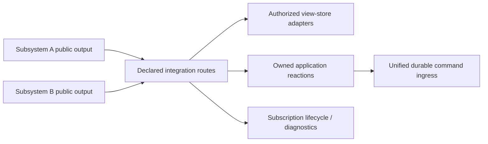

# Functional core and reactive coordination

**Direction:** Functional patterns plus reactive coordination

**Library status:** Not selected; RxJS and Effect Stream are candidates, not installed dependencies

**Implementation:** Bounded explicit lifecycle registry, gateway-owned delivery and React external-store bridge exist; native acceptance remains separate.

## React-specific design and functional preference

The product targets React; this contract does not require a framework-agnostic core or separate core/React packages. Pure domain functions and public subsystem interfaces keep responsibilities testable and effects controlled; they do not commit the product to supporting another framework. React-specific presentation hooks and bindings are appropriate within these boundaries.

Prefer functional patterns over classes, without banning classes where justified. Choose React patterns according to the actual requirement; no particular component customization pattern is prescribed. UI composition must not own domain policy or bypass managed subscription routes. Strict TypeScript is an accepted implementation convention; lint/format tool selection is deferred. For the remaining conventions, see the [architecture conventions](../rules/development.md#implementation-conventions). Strict compiler configuration and bounded runtime exist. No lint tool is selected.

## Responsibility before library choice

Keep domain decisions in small deterministic functions over explicit immutable inputs. A transition produces the next state and declared event/job intent, or a typed rejection. The dispatcher performs fresh authorization/revision checks and commits the transition and receipts atomically. Time, identity, external observations and randomness are explicit inputs; pure functions do not read a database, launch a process or call a host.

A scoped application/adapter layer owns effects: transactions, streams, host delivery, process supervision and cleanup. Reactive coordination combines committed updates, manages subscriptions and connection lifecycle, and delivers view snapshots. UI subscribes to those snapshots and submits intent. It does not hide domain rules in stream operators or component hooks. Use explicit public subsystem interfaces; do not leak a particular reactive library through every domain type.

## Bundle cross-subsystem streams at a controlled boundary

Cross-subsystem streams must pass through a declared stream integration layer. Keep the wiring together at the application composition boundary, with typed routes, a subscription registry and scoped lifecycle ownership. Do not scatter subscriptions between another subsystem's internal modules.

A module in subsystem A must not directly subscribe to a module, Subject, Observable or internal store in subsystem B, and vice versa. Export library-neutral public event/query ports; compose them only through the integration layer. Business modules neither import each other's reactive internals nor create hidden cross-subsystem subscriptions in constructors, hooks or helpers. Private streams may remain within a subsystem, but cannot become an alternate integration path. Components consume the approved view-store bridge rather than assembling their own cross-system pipelines.

The integration layer owns connection topology and lifecycle, not domain decisions. Domain writes still use durable command ingress, and host/process effects stay with their existing responsible adapters. This is one controlled composition policy with bounded routes per scope, not one global Subject, one serial subscription, or a new distributed message broker. Independent review/job channels retain concurrency and fault isolation.

## Registration, ownership and monitoring

Keep route declarations together and make every cross-subsystem subscription visible in the registry before activation. A registration records:

| Field | Required contract |
|---|---|
| Route and identity | Stable route/subscription ID, producer/consumer public ports, typed event/query contract and supported version. |
| Scope and access | Owning application lifecycle, review/project/participant scope and authorization filtering. A shared stream must not broadcast another review's private data. Revocation/replacement stops access and fences late emissions. |
| Lifetime | Creation/activation, explicit owner, reconnect behavior, teardown and terminal/disposed state. No orphan or duplicate active registration for the same logical connection. |
| Delivery policy | Ordering boundary, bounded buffer/slow-consumer policy, safe read retry limits and durable cursor/reconciliation source where applicable. |
| Diagnostics | Active/created/disposed counts, reconnect/error counts, lag/buffer pressure, terminal reason and causation/correlation references. |

Use one managed entry point for registration and teardown; keep the allowed producer→consumer graph inspectable. An undeclared route is rejected, not silently activated. Scope disposal removes its listeners and prevents later emissions from updating a replaced attachment or view. Repeated UI mounts or subscribers cannot launch another process or agent turn.

Monitor the connection graph and lifecycle centrally, while isolating failures to the affected route. Log identifiers and bounded diagnostics rather than credentials, raw conversation contents or unrestricted cross-review payloads. Diagnostic counts establish subscription state, not external job success. Failures of durable delivery remain recorded/recoverable; monitoring must not swallow them or turn them into silent data loss.

Do not create automatic cross-subsystem feedback loops. Any intentional event→command→event workflow is explicitly declared, has causation/deduplication and termination conditions, and is validated as a domain workflow. Reactive operators do not invent implicit reciprocal subscriptions or wake loops.

## Test the wiring as a first-class boundary

From the first cross-subsystem stream, the responsible slice includes:

- Import/dependency checks reject direct imports of another subsystem's reactive internals; unit tests use public-port test doubles without bypassing the production integration route.
- Route tests reject undeclared wiring and unauthorized project/review subscriptions. Both directions of any permitted interaction are visible in the topology.
- Lifecycle tests exercise mount/unmount, scope disposal, attachment replacement, disconnect/reconnect and repeated subscriptions. Active counts return to the expected baseline; disposed scopes ignore late emissions and create no duplicate external effects.
- Fault/slow-consumer tests prove bounded buffering, observable errors and independent-channel progress. Only replaceable presentation updates may coalesce/drop; accepted commands, inbox items and evidence remain durably recoverable.
- Actual own-PR E2E exercises the slice through the managed routes and inspects subscription diagnostics before/after teardown. Virtual-time tests supplement, not replace, real-host/process evidence.

Implement the smallest registry and route declarations needed by the current slice. This rule does not justify building a generic observability console or stream platform before the first useful journey. Library choice must preserve this contract whether it is RxJS, Effect or native streams.

## Where reactive behavior belongs

- Present committed review updates and job progress without conflating receipt, delivery, start and completion.
- Observe attachment/connection lifecycle and reconnect through durable cursors.
- Coalesce wake scheduling while retaining every durable inbox item.
- Cancel superseded read-only requests or private visual work, with scoped teardown.
- Keep the graph, explanation and source selection synchronized from one explicit presentation state.

## Semantics that a library cannot replace

An in-memory stream or queue is not durable command ingress, an inbox, an outbox or a job journal. Dropping or sampling redraws may be acceptable; dropping accepted commands, addressed comments or execution evidence is not. Slow-consumer policy needs explicit bounds and recovery from durable cursors.

Unsubscribing stops observation or local work according to its teardown contract. It is not evidence that an external test process stopped or a host turn never started. Cancellation remains a domain command with confirmed outcome. Reconnection/retry may repeat a safe query; it must not blindly replay uncertain launches or create a new invocationId. Multiple subscriptions must not duplicate external effects. Release resources on teardown, preserve durable effects and reconcile unknowns.

Transactions never span stream waits or agent turns. A serialized conversation must still be able to submit its own MCP commands. Functional structure and reactive operators do not, by themselves, establish atomicity, correct authorization or exactly-once external execution.

## Candidate comparison

| Candidate | Potential fit | Decision cost / question |
|---|---|---|
| Native async iteration and explicit lifecycle interfaces | A small baseline for bounded read/event pipelines | How much custom composition, buffering and teardown code does the real flow require? |
| RxJS | Event composition and scoped subscriptions, while retaining a separate domain and effect boundary | Can we keep operator graphs understandable, teardown explicit and retries restricted to safe operations? Preferred candidate if stream composition is the main missing capability. |
| Effect Stream | A broader effect model alongside streams, resources, errors and concurrency | Is adopting that model across application services justified by the actual slice? Prefer only if its broader lifecycle model pays for the additional architectural commitment. |

This is a recommendation framework, not an adoption decision. “More modern” alone is insufficient. React can consume an external store through its supported subscription interface; local rendering state does not require moving durable business state into a reactive library.

## Bounded selection evidence

Before implementing the first substantial reactive coordinator, compare the native baseline and relevant candidate against the same small scenario: committed updates, a slow/disconnected reader, cursor reconnect, attachment replacement, repeated subscriptions and teardown while an external invocation is uncertain. Use TDD and deterministic scheduling where supported, then actual adapter tests for behavior outside a virtual scheduler. No synthetic scheduler result counts as real-host or process-termination evidence.

Record the selected release, scope, rationale, observed complexity and test results in the relevant slice before adopting it. Do not introduce both libraries or an application scaffold to decide this. Any implementation experiment needs its own bounded task scope. The existing host probe remains host-only and does not depend on this library choice.

## Primary references

- [RxJS Observable contract and teardown](https://github.com/ReactiveX/rxjs/blob/master/apps/rxjs.dev/content/guide/observable.md).
- [RxJS virtual-time testing and limits](https://github.com/ReactiveX/rxjs/blob/master/apps/rxjs.dev/content/guide/testing/marble-testing.md).
- [Effect streams](https://effect.website/docs/v4/stream/creating) and [Effect service/resource/concurrency model](https://effect.website/docs/v4/getting-started).
- [React external-store subscription](https://react.dev/reference/react/useSyncExternalStore).

Sources inspected 2026-10-23. Library versions and local behavior remain unverified until the bounded implementation decision; no package is installed by this design.

Current bounded coordination uses an explicit managed registry, gateway-owned durable delivery and the React external-store bridge. Native lifecycle composition is adequate for this checkpoint; RxJS/Effect remain candidates only if future composition needs justify their cost. No stream package is required to rebuild current behavior.
