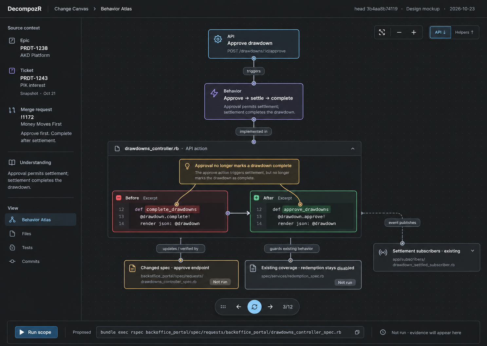
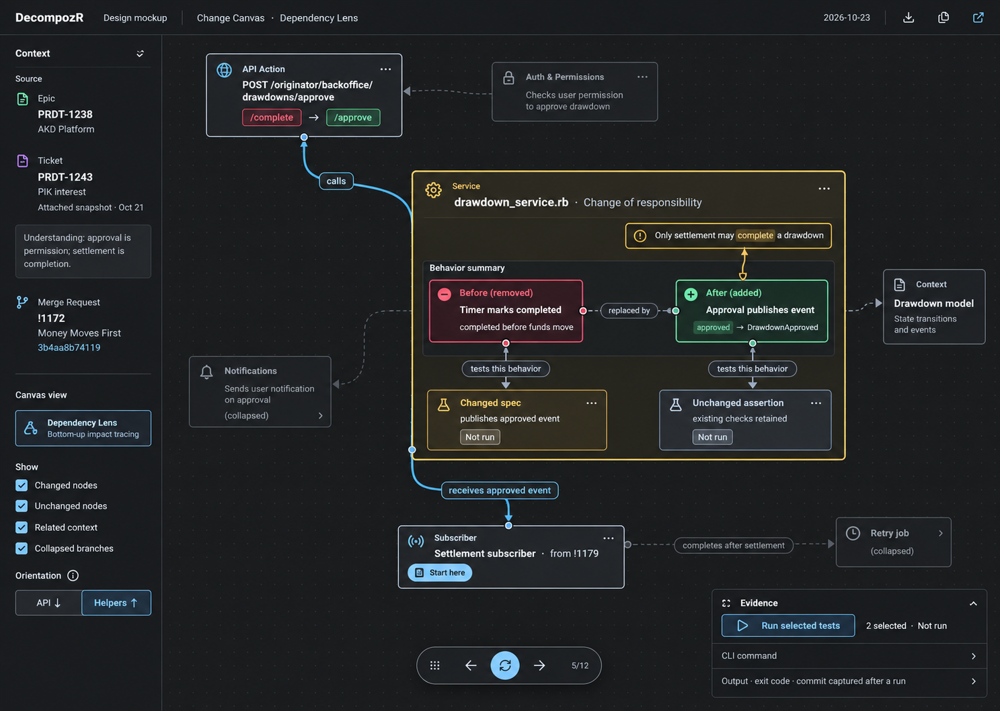
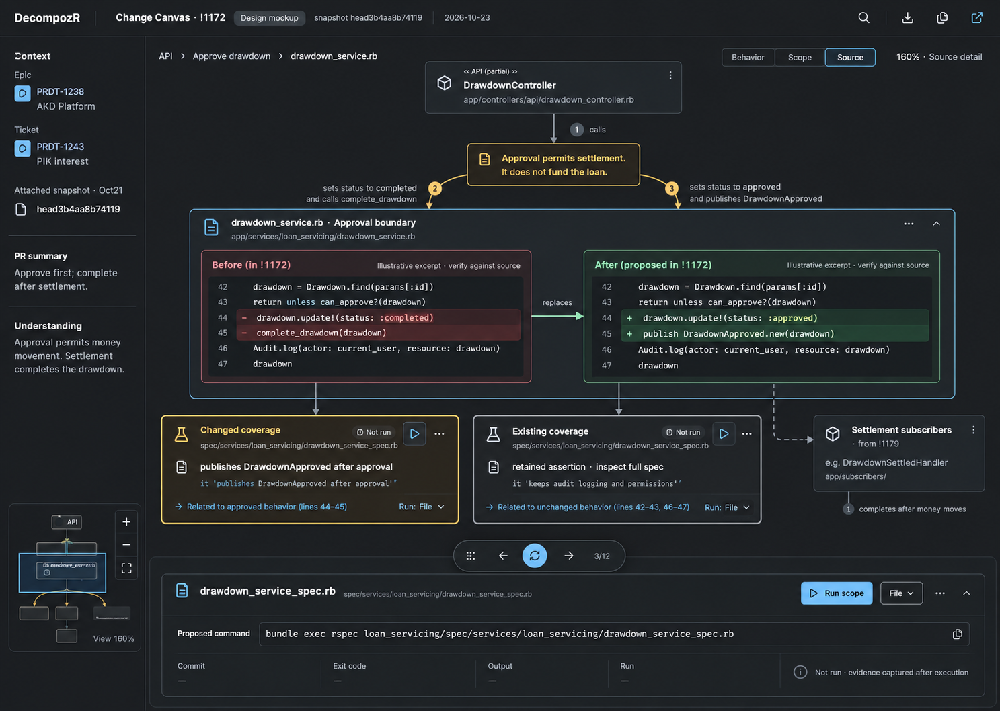

# The controlling October 23 change-canvas references

Date: 2026-10-24. Status: original requirements/source and supplied-image dissection, not a live browser audit. This supersedes the earlier lesson-centered dissection and its product-fit inference. The [whole PR25 graph](pr25-whole-change-graph.md) and [reviewer experience](review-experience.md) carry the resulting design.

## Find the actual track

The controlling source is the **October 23** discussion and final transfer, followed by the current same-canvas/comment corrections. The original request is a whole-PR change tree with nested groups and at least one level of callers **and** callees on both sides, including unchanged context. The story is an optional attention overlay on that persistent map. This is not a new requirement inferred from an October 13 slideshow, nor a request to restore the older prototype.

Full retained packets read: `pr-reviewer-transfer.md` (26 lines) and `context-supplement.md` (16 lines), under `/Users/scottchu/.codex-workspaces/artifacts/pr-diff-teacher-2026-10-23/`. Relevant original history read: `source-conversation-history.md:785–1673`; the older 615–650 passage is historical only. Archived transfer commands and old framework proposals are evidence, not current execution instructions. No retired worktree was accessed, and no fresh clarification from the original conversation is claimed.

| Controlling source location | Requirement recovered |
|---|---|
| History790–810, October23 12:54 request | Start from a graph/tree canvas; entry behavior or helper/model can be the starting point. Before-left/after-right inside groups; tests and explanations connected to changed source; unchanged tests/context present. |
| History848–861, October23 13:00–13:02 | Zoom reveals behavior → scope → actual source/test/evidence detail, with focus and relationships retained. |
| History885–914, October23 13:02–13:03 | Reject orientation/API–Helpers switches; start from any node. “I love it” supports the direction, not proof of selecting one numbered variant. |
| History929–1006, October23 13:06 onward | Summarize all changes with at least one level of callers and calls; focused groups expose changed and unchanged code/tests. Complete hunk accounting, both versions and unresolved/external relationships are part of the ensuing design. |
| History1129–1167 | Contextual questions go to the responsible attached session; persistence and delivery are distinct. |
| History1248 onward and final transfer | React19/React Flow with Node/TypeScript replaces the proposed Svelte framework, while preserving the canvas model and participant/command/job boundaries. |
| Transfer “Accepted canvas” paragraph; supplement product paragraphs | Whole-PR coverage, both-direction one-hop context, related tests, semantic zoom, stable selection and no orientation selector were explicit handoff requirements, not missing user inputs. |

## Primary visual references: the three October 23 concepts

All three original PNGs were directly viewed and copied byte-for-byte below. Generation timestamps and hashes come from the coordinator's recovered original image-generation event evidence, `/tmp/pr-reviewer-whole-graph-reference-recovery/oct23-image-provenance.json`; hashes were independently recomputed from the files. The provenance is not based solely on file modification time. This author read the recovered event metadata, not the complete original JSONL independently.

| Concept | Original generation event (UTC) | SHA-256 |
|---|---|---|
| [Behavior Atlas](references/oct23-behavior-atlas.png) | 2026-10-23T12:58:14.628Z, exec-ae774def-8444-4192-a498-ba448099464c | `8a4d8522b9ee59e2935c7053b4c2ac560aa4c4d82f868773f0693847ffe34cd6` |
| [Dependency Lens](references/oct23-dependency-lens.png) | 2026-10-23T12:59:44.439Z, exec-3f8b486c-0dc5-4505-99f9-23696abc98b4 | `77f9e91cd9f6a29e5e17ed593f0d6334f9f53c94dfbbdd3de5c5f628b539cc62` |
| [Scope Microscope](references/oct23-scope-microscope.png) | 2026-10-23T13:02:09.968Z, exec-c2c53764-65a4-445e-822e-82e523f13fb3 | `fdb363c49e1e946a77fb872ba44ce9ae781979578c615b9266e2d33472876975` |

Original files reside in `/Users/scottchu/.codex/generated_images/01a1280a-3618-7c41-b70d-71d40fafd60f/` using the event IDs above plus `.png`. They are design images, not screenshots of an implemented product. The Ruby code, MR/Ticket data, edges and commands are illustrative/attachment-derived and **not facts about PR25**. No individual choice among the three is asserted. Later removal of orientation controls overrides their appearance in the first two images.

**Observed:** compact source-context/understanding rail; behavior and file group connected through ports; before/after source child nodes; explanation node connected to changed tokens; changed and existing tests; unchanged subscriber alongside the main group. **Design implication:** explanation/source/test membership is spatial and relational. It cannot be replaced by a summary card above a detached editor. The displayed node budget is a viewport composition, not permission to omit the rest of a PR.

**Observed:** a nested service/behavior group amid API, model, notification, subscriber and collapsed branch context; highlighted route traverses a larger field. Tests and explanation are connected within the group. **Design implication:** reverse tracing from a lower-level node is a first-class entry, and dim/collapsed neighbors still exist. Do not copy illustrative arrow direction as source fact or retain the later-rejected orientation selector.

**Observed:** zoomed before/after source remains inside a graph group; explanation leaders meet specific changed spans; changed/existing coverage is nearby and connected; caller/subscriber context and minimap preserve larger-map location. **Design implication:** semantic zoom reveals detail without replacing the graph. The minimap/viewport cue is useful reference evidence; exact geometry remains a mockup decision. Tests explicitly say not run; the evidence area is not proof of execution.

Across these concepts, retain the dark editor-style foundation, readable source typography, quiet chrome, compact context rail and connected group hierarchy. Color alone does not restore the UX. The October23 spatial model controls; an older lesson layout must not override it. There is no new theme choice here.

## Correct the mistaken reference and acceptance

The ZIP `pr-diff-teacher-mockup.zip` SHA-256 `068710789c2f369e22ee4960754211dbf800b1c6ec6935375c90462b14dbc9ff` contains45 entries including five historical captures and React/Vite/Three source. Its README identifies `exec-b32a6ac2-4f1f-4503-9f5d-19c989924bd3.png` as its selected third concept. That is the **older October11 lesson/graph/diff concept**, not the October23 three-variant canvas design. The retained [older image](references/selected-lesson-graph-diff.png) remains historical evidence only; its existence and ZIP wording did not justify privileging it over the later instructions.

Earlier dissection directly viewed that older PNG, all five ZIP captures and the rejected mobile8474 screenshot. It correctly observed synchronized attention, compact player and control-wall problems, but narrowed the concrete task to one prepared request/header path. The subsequent8476 design retained one authored group and locked pan/zoom. The user rejected that product scope; earlier independent ready-for-mockup judgments are withdrawn as product-fit acceptance. Functional checks and source-informed screenshot critiques remain historical engineering evidence, not endorsement of this narrowed graph.

The original ZIP's `App.jsx` and `story-player.js` are useful historical evidence for reading pause and explicit exploration, but their curated step-driven graph cannot supply today's whole-PR membership. Its generic imports lacked semantic reconstruction; copying it would not create real relationships. The new design must not substitute a complete file-count disclosure for a connected map or make Next reveal otherwise absent groups. The correction is to recover the accepted scope and spatial interaction, not to add more story buttons or merely darken cards.

## Current evidence limits

The supplied rejected8474 image establishes visible hierarchy only; its exact running source is not established by the image. The8476 rejection and narrow implementation limits are recorded in the owning mock packet and latest user correction; this author did not launch or independently browse it. No live user browser, native session, tests, server or preview was accessed. The prior denied browser route remains denied and unrun.

The [PR25 graph specification](pr25-whole-change-graph.md) contains a concrete multi-group map, source-evidenced before/after neighborhoods, changed/unchanged test context, all50-file accounting and explicit unmodeled frontiers. This is a source-grounded design, not a claim of complete static analysis or passing tests. Independent design review precedes any authorized next mock implementation.
