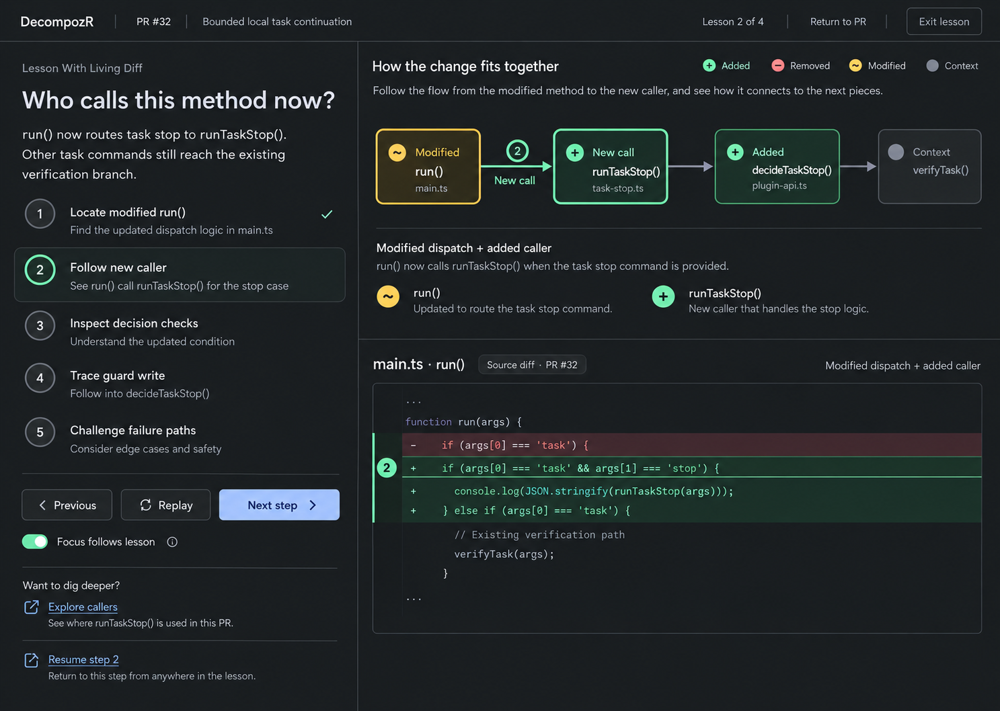

# Original review experience: reference dissection

Date: 2026-10-24. Status: source and supplied-image analysis for design review. No original app or current preview was launched. This is not a live UX audit or renewed acceptance of the old layout.

The [review experience specification](review-experience.md) derives the next design from this evidence and later user corrections. The goal is understanding changed behavior with inspectable evidence, not restoring a historical app or collecting its controls.

## Reference identities and limits

| Reference | Identity and what was actually examined |
|---|---|
| Original archive | `pr-diff-teacher-mockup.zip`, retained under `/Users/scottchu/.codex-workspaces/artifacts/pr-diff-teacher-2026-10-23/`; SHA-256 `068710789c2f369e22ee4960754211dbf800b1c6ec6935375c90462b14dbc9ff`. 45 entries include React/Vite/Three source and five screenshots. Selected README, App, graph, layout, player, styles and mobile/interface documentation sections were read as evidence, not instructions. The ZIP is the version authority for this dissection; it is not assumed byte-identical to evolving Playground main or the separate pinned Playground commit. |
| Selected generated concept | Original README “Visual target” names `exec-b32a6ac2-4f1f-4503-9f5d-19c989924bd3.png` in generated-image conversation `01a1280a-3618-7c41-b70d-71d40fafd60f`. Viewed directly; [exact-byte retained image](references/selected-lesson-graph-diff.png). Illustrative code and relationships are design content, not facts about our own PR. |
| Five archived screenshots | Viewed `surface70-desktop.jpg`, `surface70-mobile.jpg`, `behavior-groups-desktop.jpg`, `behavior-groups-mobile.jpg`, `slim-player-desktop.png` from the ZIP's reference-screenshots. They show different stages/PRs, not one simultaneous state or proof of all interactions. They remain private reference artifacts; the browser-chrome/profile capture is not copied into product docs. |
| Original user history | Retained `source-conversation-history.md`: 2026-10-23 request for a graph/tree of behavior groups, before-left/after-right, nearby changed/unchanged tests and connected explanations; 13:00 zoom-detail question; 13:02 rejection of API/Helpers orientation; 13:03 “i love it”. Earlier feedback says the top flow conveyed more than the narrative; later request asks for one slim player row. These are historical design decisions, not current runtime verification. |
| Rejected current mobile view | Supplied `1-Pasted-Image-1.jpg` attachment, viewed directly; user identifies the 8474 preview as rejected. The image itself does not establish its exact running commit or port. No live browser inspection occurred. It shows local mock/no-backend labeling, subsystem navigation, a PR25 heading, multiple control rows, provenance/legend prose, and only the beginning of a graph card near the bottom. |
| Current implementation source | PR Reviewer `7a10f4c454b90d122e6d07ab0fe5b23fa93413b8`, separate engineering candidate, not a claim that main/pilot has this UX. Relevant current presentation/canvas/story contracts and `src/ui/main.tsx` composition were read. This source read is not proof of what the rejected screenshot ran. |

The selected concept’s dark editor-style visual foundation, typography, hierarchy and quiet chrome are the baseline for the next mockup, not an invitation to choose a new palette or light-card treatment. Restoring colors alone is insufficient to restore its UX. Later compact behavior groups, the slim one-row player and same-canvas source reading supersede those specific older arrangements; exact geometry and token choices remain proposed until the mockup is inspected. The precise selected image is now located; earlier “reference images unlocated” statements describe the earlier investigation only.

## What the original makes easier

**It starts with a reviewer's question.** In the selected concept, “Who calls this method now?” dominates the left side. A short answer names the route and preserved branch. The highlighted step, graph relationship and changed source answer that same question. The reviewer does not first choose a technical subsystem. In the later Surface screenshot, the question becomes “What problem does the one-line change solve?” and the graph distinguishes a changed configuration from the existing component it configures.

**It keeps evidence and explanation synchronized.** ZIP `src/App.jsx:111–122` selects a head-specific curated model and derives the focused nodes/edge/source match from the current scene. Lines 130–158 map emphasized prose to evidence; 303–309 compose graph, current explanation and unified diff. This gives a reviewer a route from a claim to a particular source change. Inference: synchronized attention should reduce searching; no measured comprehension benefit is established by that mechanism alone.

**Its graph explains a relation rather than just showing a file inventory.** The archived Flow view labels calls between four methods; the Surface view labels configuration between two components. ZIP `ThreeGraph.jsx:197–202` exposes graph navigation plus DOM node/edge controls. `graph-layout.js` constructs a chain for a curated directed model and a relation-free layout for generic imports. This is a manually grounded illustrative model, not general call inference. Its sequence cannot be reused to invent edges for a different PR.

**Whole-change groups answer what else belongs to the change.** The later desktop screenshots put concise behavior groups above the teaching area, with a short selected-group purpose and a disclosed file list. `App.jsx:290` synchronizes group selection with story/file focus. Setup, test and documentation changes have a place without pretending each is a call edge. This is useful scope accounting, but a complete file count is not a complete explanation.

**Reading controls recede behind content.** `styles.css:1318–1325` and `App.jsx:314–330` define the single row: drag, previous, replay/pause, next, count opening chapter choices. The selected concept predates this refinement and has larger text actions; preserve the later slim-row correction. The source gives accessible names and keyboard move/reset. The screenshot alone cannot establish touch recognition or screen-reader usability.

**Mobile tells the current scene, not every desktop pane at once.** `App.jsx:291–300` supplies one question/current explanation, evidence choice and saved-exploration cue. Styles around 717–820 hide the desktop lesson and alternate graph/diff panes. Mobile reference captures show actual source or a short explanation as the reading content. The player remains a compact row. This offers a useful attention hierarchy; the pane-switch implementation is superseded below.

## Original limits we must not import

- The diff is a separate section on desktop, and mobile hides graph while showing Diff. It does not satisfy the later requirement that zoom/focus reveal source inside the same graph group.
- The model is curated for fixed Flow/Surface heads. README explicitly says general imports show file changes without automatic semantic reconstruction. A pleasing arrow chain does not establish calls, impact, intent or runtime behavior.
- `App.jsx:205–225,319–326` supports exploration and returning to a story cursor, but this source does not establish today's exact persisted viewport/two-draft/authorization recovery guarantees. Preserve current stronger ownership contracts instead of copying its state code.
- `story-player.js` replays three emphasis beats in the current scene, then pauses; it does not advance long text on a timer. Current PR Reviewer story semantics instead describe eight-second progression. This is a real design difference, not a reason to claim the implementations match. The next design evaluates a reading stop; current runtime semantics remain documented until explicitly revised.
- Long source still scrolls, the selected reference uses substantial sidebar space, and screenshots show a floating player near source. Do not reproduce occlusion or assume a fixed height works on a phone. Historical prototype checks did not establish physical-phone or unfamiliar-human acceptance.
- The selected visual includes explanatory wording such as “new caller” around a new callee. New content must use directionally correct caller/callee language verified against its actual source; illustrative typography is not semantic authority.
- No archived success count proves the user's understanding. The archive itself records that the narrative was insufficient and the graph gave the most immediate understanding.

## Why the rejected composition drifts

Observed in the supplied mobile image: six subsystem destinations consume two rows before the PR explanation; Back, Resume, Focus source, Zoom into selected group and More context appear together before useful graph reading; technical provenance and legend text take another band. The first visible source card starts low in the viewport. The image contains a useful PR title and one-sentence task, but no immediately legible changed relationship or concrete before/after example beside them.

Interpretation: the reviewer must decide how the tool works before seeing what the change means. Independently valid controls were composed as equal destinations. “Focus source” and “Zoom into selected group” expose two implementations of the same reading intent. Counts, provenance and safety labels are necessary information, but their repeated full-width presentation displaces the explanation they qualify. Replacing these buttons with icons alone would not fix the missing hierarchy.

This diagnosis is bounded to that screenshot and source composition. It does not establish scroll behavior, actual error handling, startup timing or a live walkthrough. The screenshot's sample caller label is not proof of that caller. Current candidate `main.tsx:205,259–261` separately composes Imports, StoryPanel, SemanticPanel and structural SourceCanvasGraph; that is evidence of partial subsystem integration, not evidence that one reviewer experience is complete.

## Reconciliation with accepted direction

| Keep from the reference | Apply the later correction |
|---|---|
| A concrete question and concise why/what/how/example synchronized with evidence | Explanation is connected to its highlighted group/span on one persistent canvas; do not turn narration into a separate obligatory tour. |
| Visible changed/unchanged relationships and explicit unknowns | Use only retained structural/static relations or attributed claims. Expand source in the same group; preserve before-left/after-right, or labeled stacking at narrow widths. |
| Small player and reading/exploration pause | One row, optional movement, no covered text, saved exact story return. Evaluate reading-stop timing explicitly; do not silently replace current application transitions. |
| Colored source changes and scoped file accountability | Color plus text/markers; no source-side toggle that erases comparison. Supporting files remain accounted for without drawing fictional causality. |
| Inspecting evidence then returning | Inspection is separate from a question draft. Contextual selection → comment, human/agent identity and exact anchors survive zoom/lens/return. Unsupported prose persistence stays visibly mock-only. |
| Responsive attention hierarchy | Narrow focus is a presentation of the same graph, not an independent file page. Preserve a neighborhood/return cue while making text readable. |

React, strict TypeScript, React Flow, application-owned state, managed integration, immutable source and durable command/participant boundaries remain current. The ZIP's older framework proposal, APIs and app implementation are not restoration instructions.
