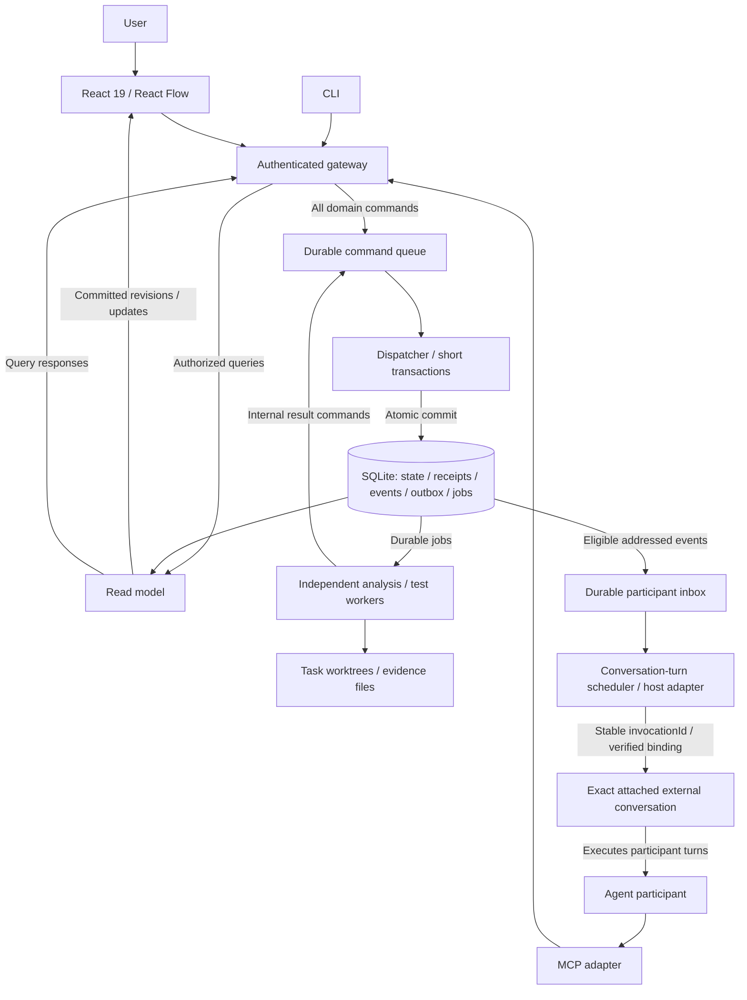

# Agent-attached change canvas: system design

**Date:** 2026-10-23

**Design status:** Accepted direction; Astra medium review corrections incorporated.

**Implementation status:** Architecture contracts remain unimplemented.

**Current frontend:** React 19.2

**Current build tooling:** Vite

**Current graph renderer:** Three.js

## Intent and accepted canvas

Help reviewers understand the whole PR/MR, enter at any behavior/source node, follow context and discuss evidence with the attached agent. User and agent are participants using the same domain commands and permission model through UI, MCP and CLI. Effective permissions depend on authenticated grants. The agent conversation runtime executes turns, initially in an existing external conversation; hosted execution is optional later. Decisions API integration is deferred.

- Compact Epic/Ticket/PR context rail, separate agent understanding, provenance, freshness and explicit missing sources.
- Whole-PR file/hunk coverage ledger and behavior groups; shared references never double-count primary coverage.
- Before-left/after-right group nodes with colored diff, unchanged context, explanations anchored to actual spans, and related changed/unchanged tests. This future canvas does not change the retained unified-diff prototype.
- One-hop callers and callees on both sides, including removed callers and unchanged dependencies. Unresolved is distinct from confirmed leaf. Non-code changes expose consumers/dependencies.
- Semantic zoom and manual expansion preserve stable selection and anchors. No API/Helpers orientation control.
- Graph leads plain-English storytelling: brief why, actual behavior/how and concrete example. UI synchronizes step number and evidence across graph/explanation/diff; narration does not instruct readers to locate changes. Removal red, addition green and modification yellow need labels beyond color. Minimal icons for operations; text for information.
- Preserve one-row draggable bottom-center player (drag, previous, replay/pause, next, step count/chapter selector), accessible labels/tooltips, mobile synchronized Flow/Diff, reading pause and exploration/resume. Rejected oversized player and verbose narration are not design targets.
- Role, test technique (mock/stub), and risk are separate evidence-backed, correctable dimensions. Prefer request/response adapter or contract mapping when that is what “template” means; use generated only with generator evidence. Helpers and wrappers are not inherently low-risk.
- UI/MCP/CLI share commands and read model. Viewport/hover remain private; explicitly shared focus is durable.

Observed gap: the imported prototype has curated Flow #32 and Surface #70 examples, a GitHub importer and ephemeral SSE focus. It has no durable queue, SQLite backend, MCP attachment, host wakeup, React Flow canvas or durable test jobs. Connection-count delivery is not UI adoption. See [transfer and validation](project-transfer.md).

## Accepted system shape

**Frontend:** React 19

**Canvas:** React Flow

**Frontend tooling:** Vite

**Backend runtime:** Node.js

**Backend language:** TypeScript

**Durable database:** SQLite

**Evidence storage:** Referenced artifact files for source snapshots, patches and execution logs.

Domain contracts are independent of renderer and transport. Framework/backend migration is future work.

| Component | Responsibility |
|---|---|
| React / React Flow | Source-backed groups, ports, selection, semantic zoom, diff/explanation/test evidence and private viewport. |
| Gateway | Derive actor identity, authorize bounded queries and command submission; same contracts for UI/MCP/CLI. |
| Queue / dispatcher | Persist ingress, deduplicate commands, validate action-specific invariants and apply short transactions, partitioned by required invariant. |
| SQLite / read model | Authoritative domain records, receipts, events/outbox/jobs/inbox and revisioned projections. Initially queries may read SQLite directly. |
| Workers | Independently leased analysis/test jobs outside transactions, authenticated internal result commands. |
| Evidence files | Immutable/content-addressed source, patches/logs and digests linked to metadata; private runtime state outside Git. |
| Scheduler / host adapter | Schedule exact conversation turns; deduplicate/query external invocations and reconcile unknown effects. Unsupported wakeup is pending/degraded. |

## Common command ingress and concurrency

Every domain write uses common durable ingress: comments, replies, graph edits, shared focus, test requests, cancellation, attachment/inbox changes and worker results. Authorized reads query the read model directly and do not wait behind long jobs. Durable enqueue acceptance is distinct from applied command success.

Envelope: commandId, action, review/snapshot, typed payload, action-specific expected revisions, applicable attachment generation, causationId and correlationId. Server derives actor from authentication, never from caller-supplied author. Store a canonical action/target/payload fingerprint with identity-scoped commandId. Identical retries return recorded receipts; changed payload with the same commandId is rejected. Reauthorize receipt disclosure. Authentication, authorization and generation are checked again at apply time; revoked or stale queued writes cannot apply.

A short dispatcher transaction atomically commits domain state, terminal receipt, events/outbox and job creation. Rejection records a durable failure without partial domain changes. No subprocess, network request, MCP call or conversation turn is awaited inside the transaction. Partition ordering only where required by invariants; there is no global serial worker or participant-wide execution lock. SQLite writer serialization remains brief. Independent jobs do not block comments.

| Action | Conflict boundary |
|---|---|
| Comment create | Validate snapshot and immutable anchor; no graph revision requirement. |
| Reply create | Thread/snapshot validation and deduplication, independent of unrelated comments. |
| Annotation/resource edit | Resource-specific CAS/revision. |
| Atomic graph patch | Graph CAS and complete reference validation; unrelated comments do not increment graph CAS. |
| Shared focus | Own channel revision/order, snapshot/target validity and explicit follow policy. |
| Test request/cancel | Target/job identity, authorization, deduplication and allowed transitions. |
| Worker result | Scoped worker authentication, job/invocation/execution epoch and allowed state transition. Preserve late evidence without overwriting newer terminal results. |

Receipts include resulting resource revisions and emitted event cursor. Queries may require a minimum receipt revision/cursor for read-your-writes. An asynchronous projection must wait boundedly or return explicit pending, never stale data labeled current. Transport updates and UI application are separate evidence.

## Identity and deadlock prevention

Participant is a stable authenticated principal, distinct from attachment, conversation turn and job. Users and agents can invoke permitted commands through all entry points. Workers use separately scoped service identities.

Attachment records verified host and exact conversation identity, review/snapshot, generation, supported transport/wakeup/dedup/query capabilities and liveness evidence. A supplied conversation ID alone is not identity proof. Replacement advances generation; queued writes are checked at apply, so old agents cannot write after replacement. Previously authorized independent jobs may finish and preserve historical results under their original snapshot/authorization; do not relabel them as new-owner work. Revocation may separately request cancellation.

Keep participantId, attachmentId/generation, turnId, commandId, jobId, invocationId and worker execution epoch separate. Serialize conversation turns only. Never hold a participant-wide command lock, domain transaction or a mutex needed by MCP handlers while awaiting MCP/jobs. The active conversation must be able to issue commands and read results during its own turn; independent workers continue without self-deadlock.

## Command success, job lifecycle and external effects

Command states: queued → applied or rejected. Test-request success means an authorized durable job was created, not that a process started or tests passed. Jobs separately track queued, launching, running, cancellation-requested, succeeded, failed, cancelled or unknown with supporting evidence. Passing requires confirmed successful exit and matching source/environment.

Cancellation is a separate durable command. Receipt confirms recorded intent. Show cancelled only after confirmed process termination and outcome reconciliation. If completion wins the race, retain the actual terminal result and cancellation outcome. Missing termination/exit evidence stays unknown or cancellation-requested as appropriate; disconnect is not cancellation.

External process launches and wakeups use stable invocationId distinct from commandId; a command may create multiple jobs/effects. Persist invocation intent in the outbox, perform the effect outside the transaction, and retain invocationId across retries. Host/supervisor must support deduplication and query/reconciliation by that ID. Outbox delivery is at least once, not exactly-once external execution.

If acknowledgement is lost, query host/supervisor evidence by invocationId before deciding what happened. Unknown launch cannot be blindly retried. Without dedup/query support, preserve unknown and block automatic relaunch until reconciled. A known non-start may retry by policy with durable attempt history. An intentional new run gets a new job/invocation. Leases/epochs fence internal results but do not deduplicate external launches.

## Wake triggers and durable comment loop

Wake only for explicitly addressed user requests and subscribed terminal job events. Own replies, own graph changes, delivery receipts and acknowledgement bookkeeping are excluded by default. Unrelated jobs do not wake every participant. Carry causation/correlation through commands, events, jobs, invocations and replies to prevent feedback loops.

1. Comment command validates snapshot/anchor. Atomic apply saves comment, receipt, event/outbox and eligible addressed inbox item. UI can say saved.
2. Durable inbox retains item identity, ordered cursor, target participant/generation, causal context and consumption records. Notifications are hints; paginated cursor reads recover events.
3. Scheduler coalesces wakeups without dropping inbox items. Serialize turns for the exact conversation. Busy turns leave later items pending; each invocation records its input set/high-water mark.
4. Adapter verifies binding/generation/capabilities and uses stable invocationId. Record attempted delivery, host acceptance, actual turn start and completion independently. Unsupported wakeup stays pending/degraded. A receipt is not turn-start proof.
5. Agent reads exact source context through MCP, submits replies/patches/test requests through common ingress and reads receipts. Awaiting a job holds no domain lock.
6. Acknowledgement is another idempotent command, allowed after durable reply/mutation or explicit no-change disposition. Consume individual items and advance only the contiguous cursor, preserving gaps. Crash redelivery uses command dedup; external effects still need invocation reconciliation.

Show saved, pending/degraded, delivered, started/processing and answered separately. Turn completion is not a persisted reply; verify reply receipt and UI revision. Native delivery remains unverified until the exact real-host loop passes.

## Authoritative records and anchors

| Record | Required identity/evidence |
|---|---|
| Review / Snapshot | Repository/PR, exact base/head, diff-base semantics, completeness ledger and actual worktree content identity. |
| Group / SourceAnchor / Edge | Primary hunk coverage, immutable snapshot/side/path/range/hash, relation type and resolved/observed/agent-inferred provenance. |
| Annotation / TestLink | Own revision, role/technique/risk/explanation evidence, author/freshness; relevance distinct from execution result. |
| Comment / Reply | Thread, immutable original anchor/snapshot, actor, originating request and evidence. |
| Participant / Attachment | Stable principal and verified host/conversation/generation/capabilities, distinct turn/job identities. |
| Command / Receipt | Payload fingerprint, authenticated actor, apply-time authorization, outcome, resource revisions and event cursor. |
| Event / Outbox / Inbox | Addressed recipient, cause/correlation, durable cursor, attempts and item consumption. |
| Job / Invocation / Run | Configured targets/argv, authorization, invocationId/epoch, actual content digest/dirty state, environment, process/exit evidence and artifact digests. |
| Layout / ViewState / SharedFocus | Layout separate from semantic anchors, private viewport/hover, explicit durable versioned shared focus. |

Prepare a pinned-head worktree plus a read-only baseline source view using the recorded diff-base strategy. Inspect callers and callees from both source sides, including deleted callers and unchanged dependencies. A baseline execution worktree is needed only when actually running a comparison.

A new head creates a new snapshot. Old-head comments and runs remain historical, never silently rebased to current layout/head. Renames/symbol mappings need explicit evidence. Zoom/layout never rewrite anchors or graph meaning. Binary/large unavailable patches remain explicit. Record source-change status, test relevance and run result independently; a definition is not a run and unchanged tests do not prove validity. Base/head comparison retains separate environment-qualified results. Importing never executes installation hooks.

## Proposed operation surface

These tools are contracts, not currently available MCP operations. Negotiate actual transport/client capabilities with the real host. MCP access does not itself wake a conversation.

| Operation | Kind/result |
|---|---|
| review_attach / replace | Command: verified binding/generation with normal permissions. |
| review_read / review_events / review_get_run / command_read | Authorized bounded queries with provenance, revision/cursor and explicit pending/unavailable data. |
| review_comment / review_reply | Commands: anchor/thread validation, deduplication and durable receipts. |
| review_patch | Command: atomic graph patch with graph CAS or explicit resource edit with own CAS. |
| review_focus | Command: durable shared focus; follow policy determines adoption. |
| review_run_tests | Command: configured target IDs, no arbitrary shell strings; success returns created jobs. |
| review_cancel_run | Separate command: cancellation intent; process reconciliation proves termination. |
| review_ack_event | Command: consume specific inbox items after durable disposition. |
| worker_result | Internal command: authenticated job/invocation/epoch and evidence. |

## Bounded implementation and acceptance

This transfer imports the prototype and revises design only. No runtime migration, connector installation, host wakeup, new deployment, publication or source archival is included. Preserve the source preview/worktree. Local build/tests are distinct from architecture acceptance.

1. Prove the exact native external conversation comment → MCP read → durable reply → UI loop, with authenticated binding and actual transport/wakeup evidence. Bound to one local session. Unsupported wakeup blocks direct-delivery claims; independent graph work can proceed.
2. Exercise duplicates, changed-payload commandId rejection, restart/redelivery, comments during long jobs, turn-awaiting-MCP/job deadlock prevention, unknown launch without blind retry, stale generation and revoked authorization at apply. Preserve independent historical job provenance. Record delivered/start/completion/reply application separately.
3. Exercise resource/graph CAS: conflicting graph patches cannot partially apply; unrelated comments do not conflict; old-head anchors remain historical; receipt-aware reads catch up or report pending.
4. Add React Flow groups, source/explanation/test nodes, semantic zoom and manual expansion with stable anchors/selection and design-system foundations.
5. Import one representative PR and selected language/framework: all hunks accounted for; one-hop relationships or unresolved/leaf states; unchanged tests/dependencies and unsupported/binary evidence visible.
6. Enrich through MCP with provenance, correction retention and invalid-reference rejection. Configured test execution must prove actual content/environment, deliberate failure, cancellation races, confirmed termination and unknown exit. CLI/UI share command/job outcomes.

Pending first-slice inputs: verified host adapter capabilities/binding, negotiated MCP transport, selected language/framework and existing configured test targets. Physical-phone, screen-reader journey and measured comprehension remain unverified. General multi-agent ownership, remote workers, automatic PR posting and Decisions integration are deferred.

## Astra medium review reconciliation

All seven packet findings are incorporated: (1) turn-only serialization/no held domain locks; (2) command/job/cancellation separation; (3) external invocation identity/reconciliation; (4) explicit wake eligibility and durable coalesced inbox; (5) stable authenticated identity and apply-time generation checks; (6) action-specific CAS and immutable anchors; (7) partitioned dispatch, independent jobs and revision-aware reads. This is a same-agent documentation check, not a new independent review or runtime acceptance.
